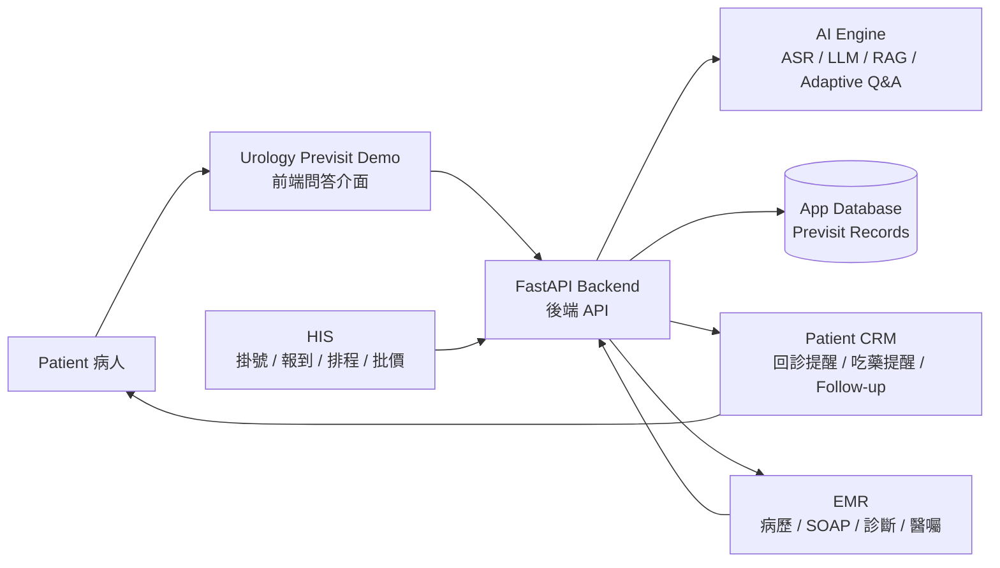
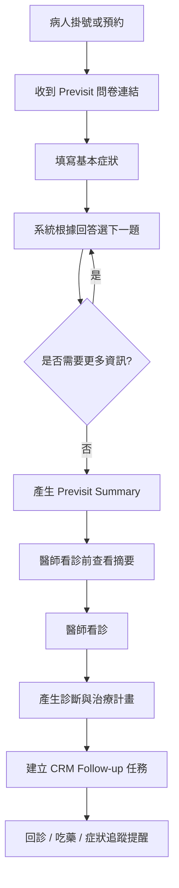
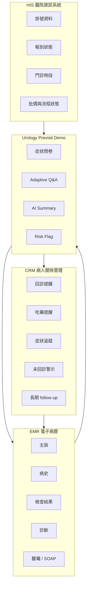
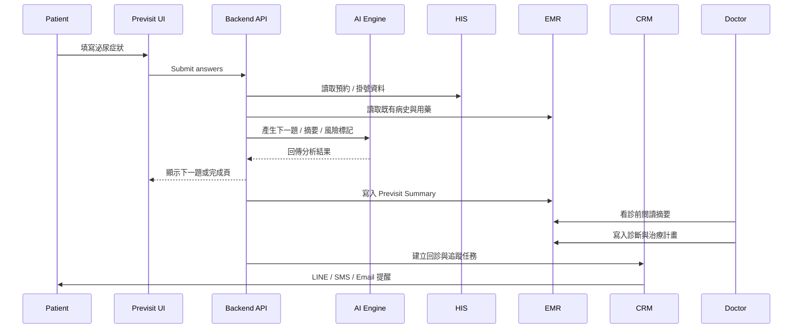
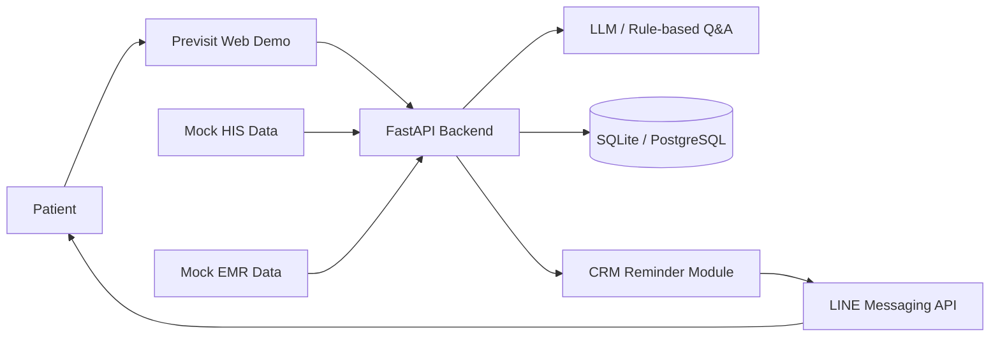
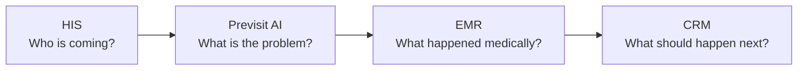

# LINE-based Urology Follow-up CRM

Canonical Idea OS record: `ideas/structured/idea_000034_line_based_urology_follow_up_crm.yaml`

## Capture Boundary

This is a detailed brainstorm capture with a short planning bridge.

Current rule:

> 完整記錄 CRM / HIS / EMR / urology follow-up MVP 的想法；planning 只保留 locator / status / capacity，詳細推理留在 brainstorming-lab。

Planning bridge was added on `2026-05-19` after the user explicitly asked for FIRST PRINCIPLE planning sync. The bridge does not create a new execution lane, hospital deployment sprint, or HIS / EMR integration task.

## Core Claim

This idea is feasible because it is not trying to build a full hospital information system, full electronic medical record, or medical AI diagnosis engine.

The useful wedge is narrower:

> 病人離開診間後，醫療流程就斷掉了。

The MVP should therefore be a clinic-grade follow-up CRM: medication reminders, symptom check-ins, return-visit reminders, and staff-visible follow-up status.

The product frame is:

> AI Systems Engineering for Real-world Deployment

This means the work should start from a real-world workflow pain, build the smallest working demo, stay understandable to clinic staff and physicians, and leave room for later AI integration.

## What Not To Build First

Do not start with:

- full HIS
- full EMR
- full FHIR interoperability
- autonomous medical AI
- diagnosis or treatment recommendation
- full medical-law or compliance platform
- real patient-data storage in the prototype

Those are too broad for a first MVP.

Start with:

- patient follow-up record
- LINE-based reminders
- medication adherence support
- symptom improvement check-ins
- return-visit tracking
- staff dashboard

## MVP v1

Only four product functions are needed:

| Function | Minimal content |
| --- | --- |
| Patient creation | Name, phone or LINE contact, condition, medication, return-visit date |
| Return-visit reminder | LINE first; SMS and email later |
| Medication reminder | Daily fixed reminder or simple schedule |
| Follow-up status | Improved, not improved, no response, returned, overdue |

This is the smallest version that can be shown to a clinic.

## Example Workflow

Visit closes:

```text
Diagnosis:
BPH

Medication:
Tamsulosin

Return visit:
14 days later
```

Staff clicks:

```text
Create Follow-up
```

The system schedules:

| Day | Action |
| --- | --- |
| Day 1 | Medication reminder |
| Day 3 | Symptom check-in: "Has urination improved?" |
| Day 7 | Follow-up check-in |
| Day 14 | Return-visit reminder |

Staff sees a simple follow-up queue:

- improved
- not improved
- no response
- returned
- overdue

## Why This Is Not Medical AI Yet

The first product is medical workflow management.

That matters because:

- CRM is easier to validate than AI diagnosis.
- Clinic workflow is easier to demo than model performance.
- Reminder and response events can be tested without large datasets.
- Human staff remain the decision point.
- AI can be added later only where the workflow produces observable data.

The product value is not the reminder itself. The value is retention and continuity:

- fewer missed return visits
- less broken chronic-condition follow-up
- better patient engagement
- clearer clinic work queue
- a future event stream for adaptive AI routing

## Best First Product Cut

The best first product cut is:

> LINE-based Urology Follow-up CRM

This is narrower and more realistic than a broad hospital platform.

The product asks:

> Can a small clinic understand, trust, and try this today?

## Recommended Stack

Frontend options:

- Streamlit
- Next.js

Backend:

- FastAPI

Database:

- SQLite for MVP
- PostgreSQL later

Notification:

- LINE Messaging API first
- Twilio SMS later
- Email later

Deployment:

- Docker
- VPS, Railway, or Render

For the very first demo, LINE can be mocked as message previews before live integration.

## CRM Definition

CRM means:

> Customer Relationship Management

In Chinese:

> 客戶關係管理系統

The important point is that CRM is not just a customer list. It is a system for managing ongoing relationship history and next actions.

For a clinic, the question is not only:

> Has this patient visited before?

The CRM questions are:

- When was the last visit?
- How is the patient now?
- Did the patient return?
- Has the patient dropped out?
- Should the clinic remind them?
- Is the patient now high risk?
- What interactions already happened?

In a medical setting this becomes:

> Patient Relationship Management

It manages the long-term interaction between the patient and the clinic, not the clinical record itself.

## CRM vs Database

A database stores data.

Example database row:

```text
Name:
Wang Xiaoming

Phone:
0912...
```

A CRM manages relationship workflow.

Example CRM history:

```text
4/12:
Return-visit reminder sent.

4/13:
No response.

4/15:
Nurse called patient.

4/16:
Patient reported worsening symptoms.

4/17:
Earlier return visit arranged.
```

This is a different product category.

## Real-world CRM Instances

### Healthcare CRM

Urology clinic:

```text
Patient:
Mr. Wang

Condition:
BPH

Return visit:
Two weeks later
```

CRM actions:

- remind return visit
- track medication reminders
- record symptom improvement
- mark high-risk no-response cases
- remind staff to follow up

### Insurance CRM

An insurance agent cannot remember hundreds of clients manually.

CRM record:

```text
Client:
Ms. Lin

Last contact:
4/12

Interest:
Investment-linked insurance

Family context:
Child enters high school this year

Possible timing:
May need funds in June
```

CRM actions:

- remind agent after two weeks without contact
- send birthday greeting
- flag renewal timing
- prepare next conversation context

### Automotive CRM

A Tesla-like sales CRM can track:

- which model the person viewed
- whether they test drove
- which configuration they prefer
- whether they ordered
- whether they cancelled

Then it can trigger:

- email follow-up
- app notification
- promotion message
- test-drive scheduling

### Streaming Engagement CRM

A Netflix-like engagement CRM tracks:

- what the user watches
- when the user stops watching
- how long they have not logged in
- what they may like
- whether they may churn

Then it can recommend or re-engage.

This is not sales CRM, but it uses CRM-like relationship lifecycle thinking.

### School CRM

A university or school can use CRM logic to track:

- students at risk of failing out
- long-term absence
- unpaid tuition
- possible leave of absence
- counseling needs

Then it can:

- contact the student
- notify the advisor
- schedule counseling
- create an intervention workflow

## HIS Definition

HIS means:

> Hospital Information System

In Chinese:

> 醫院資訊系統

HIS is the hospital or clinic operations system. It is like an ERP or operating system for the medical institution.

It manages:

- registration
- check-in queue
- billing and insurance flow
- inpatient bed management
- pharmacy routing
- lab and imaging scheduling
- administrative reports
- next-visit appointment logistics

Real-world urology hospital flow:

1. Patient registers at the front desk.
2. Patient checks in.
3. Physician sees the patient.
4. Physician orders medication or exams.
5. Patient pays.
6. Patient picks up medication.
7. Patient books the return visit.

HIS coordinates much of this operational chain.

## EMR Definition

EMR means:

> Electronic Medical Record

In Chinese:

> 電子病歷

EMR stores the patient's clinical record.

It manages:

- chief complaint
- history
- medication and allergy history
- diagnosis
- SOAP note
- lab results
- imaging reports
- physician orders
- treatment and follow-up plan

Real-world EMR note:

```text
Chief complaint:
Frequent urination and nocturia for three months.

History:
Nocturia 3-4 times per night, weaker urinary stream.

Assessment:
Benign Prostatic Hyperplasia.

Plan:
Tamsulosin 0.2mg QD, return visit in two weeks.
```

This is EMR content.

## HIS vs EMR vs CRM

Short version:

> HIS manages hospital or clinic operations. EMR manages the patient's medical record. CRM manages the ongoing relationship and follow-up workflow.

| Layer | Core responsibility | Example |
| --- | --- | --- |
| HIS | Operations | Registration, check-in, billing, pharmacy, exam scheduling, appointment logistics |
| EMR | Clinical record | Symptoms, history, diagnosis, orders, test results, SOAP notes |
| CRM | Relationship workflow | Reminders, responses, no-response queue, retention, follow-up state |

For this idea:

| Product layer | What it owns |
| --- | --- |
| HIS | Whether the patient registered, checked in, paid, received medication, and booked a return visit |
| EMR | The clinical story, diagnosis, medication, physician note, and treatment plan |
| Follow-up CRM | Whether the patient was reminded, responded, improved, missed follow-up, or needs staff attention after leaving the clinic |

The MVP may eventually read selected data from HIS or EMR, but it should not start there.

## MVP Integration Rule

Start with manual staff entry:

```text
Name
Contact route
Condition type
Medication
Return-visit date
Reminder rule
```

Reason:

- hospital permissions are hard to obtain
- patient data is sensitive
- HIS and EMR vendors differ
- APIs may not be available
- security review is heavy
- integration cycles are slow
- writing back to EMR increases medical responsibility

The correct MVP positioning is:

> A patient follow-up CRM layer outside HIS and EMR.

It fills the gap after the patient leaves the clinic.

## Real-world HIS / EMR / CRM Example

Patient:

```text
Name:
Mr. Wang

Diagnosis:
BPH

Medication:
Tamsulosin

Return visit:
14 days later
```

HIS handles:

```text
Mr. Wang registers for urology.
Check-in is completed.
Billing is completed.
Medication pickup is routed.
The 14-day return visit is booked.
```

EMR records:

```text
Chief complaint:
Frequent urination and nocturia.

Diagnosis:
BPH.

Medication:
Tamsulosin.

Plan:
Return in two weeks.
```

The Follow-up CRM handles:

```text
Daily 8 PM medication reminder.
Day 3 symptom check-in.
Day 7 side-effect or no-improvement check.
Day 13 return-visit reminder.
Day 14 pre-visit status summary for clinic staff.
```

This is the product boundary:

> Do not replace HIS. Do not replace EMR. Add the missing follow-up workflow after the visit.

## Commercial Value

The value is not only reminders.

The real value is:

> Patient retention and continuity.

Clinic pain points:

- patients do not return
- long-term follow-up breaks
- chronic disease management is difficult
- patient engagement is weak
- staff do not have a clear follow-up queue

Relevant specialties:

- urology
- diabetes
- hypertension
- sleep medicine
- psychiatry
- rehabilitation

## Future AI Layer

AI should enter after the workflow is stable.

Possible later directions:

- dynamic follow-up routing
- adaptive symptom questionnaire
- non-adherence detection
- risk scoring for non-response or worsening self-report
- explainable clinical workflow suggestion
- patient clustering
- adaptive reminder frequency

The AI claim should remain:

> AI helps manage patient workflow.

Not:

> AI diagnoses or treats the patient.

## Research Value

This can become research-relevant because it is a real-world deployment problem:

- human workflow design
- messaging reliability
- response and non-response interpretation
- privacy boundary
- auditability
- clinic staff burden
- human review and accountability
- adaptive routing under safety constraints

The research direction is closer to:

> Explainable Clinical Workflow AI

than:

> AI diagnosis.

## Phases

### Phase 1: 2 to 4 weeks

Scope:

- patient management
- LINE notification mock or adapter
- return-visit reminder
- medication reminder
- SQLite

### Phase 2

Scope:

- symptom tracking
- questionnaire
- staff dashboard

### Phase 3

Scope:

- AI follow-up suggestion
- non-adherence risk scoring
- adaptive routing

### Phase 4

Scope:

- FHIR or EMR integration after workflow validation

## Real-world Pressure Test

Scenario:

A BPH patient receives Tamsulosin and is asked to return in 14 days. The patient ignores the Day 3 check-in and reports no improvement on Day 7.

Expected failure modes:

- patient does not respond
- patient says "no improvement"
- staff dashboard gets noisy
- reminder channel fails
- wording accidentally sounds like medical advice

Smallest test:

Run five synthetic patient timelines and check whether a non-technical reviewer can identify the correct staff action within one minute.

Decision metric:

Continue only if the reviewer understands the workflow, safety boundary, and next staff action without the system making clinical claims.

## Smallest Next Build

Build a local synthetic prototype with:

- patient list
- create follow-up form
- follow-up timeline
- message preview
- follow-up status dashboard
- no real patient data
- no diagnosis or treatment recommendation

Implementation options:

- Streamlit for fastest prototype
- Next.js for a stronger product demo
- FastAPI plus SQLite if a backend is needed immediately
- LINE Messaging API can start as mocked message previews before live integration

## Mermaid: System Overview



Use this as the first proposal or demo diagram. It shows the previsit demo as the interaction layer, CRM as the follow-up layer, HIS as operations, EMR as clinical record, and AI as the question/summary engine.

## Mermaid: Patient Previsit Flow



This captures the product value:

> Before the visit, organize the patient's information. After the visit, keep follow-up from breaking.

## Mermaid: HIS, EMR, CRM Boundary



This diagram prevents a key misunderstanding:

> The goal is not to rebuild HIS or EMR. The goal is to add a previsit plus follow-up intelligence layer beside them.

For MVP purposes, HIS and EMR should be mocked or manually entered, not formally integrated.

## Mermaid: Data Flow Sequence



This is useful for system-design documentation. For v1, replace HIS and EMR calls with mock data or manual entry.

## Mermaid: MVP Architecture



This is the most practical build version:

- no formal HIS integration
- no formal EMR integration
- synthetic or mock data
- CRM reminder module
- LINE can start as preview-only

## Mermaid: One-sentence Positioning



This is the shortest explanation:

> HIS knows who is coming. Previsit AI helps understand the patient's problem. EMR records what happened medically. CRM tracks what should happen next.

## Current Decision

Record the CRM idea completely, and expose it to planning as a locator/status/capacity bridge only.

Do not:

- add weekly capacity commitments
- create an execution repo
- merge it into the existing urology demo roadmap
- treat it as an active project lane
- treat it as hospital deployment, real patient-data, HIS / EMR writeback, or clinical-use work

Do:

- preserve the idea as a standalone Idea OS record
- keep the human-readable explanation here
- keep safety boundaries explicit
- let planning point here as the canonical detailed idea record
- revisit execution only when there is a scoped MVP request or project-graduation decision
