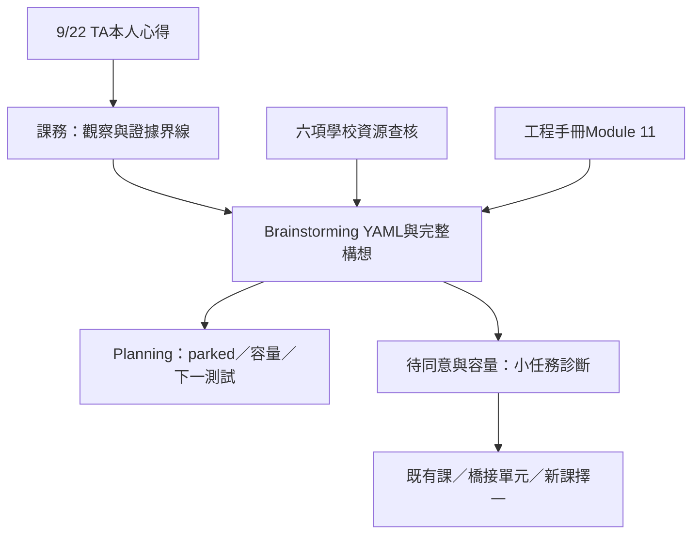

# 在職初學者的 AI 輔助軟體開發素養：9/22 TA心得與課程構想

日期：2026-09-22。狀態：收件／待驗證，未啟動課程提案、試教或對外邀請。[Canonical YAML](raw/idea_000048_ai_software_literacy_for_working_professionals.yaml)（idea_000048；raw；成熟度0/100＝尚未評估）保存狀態與下一個測試。[TA觀察原點](../../nycu-115-1-coursework/cscm30018/reflections/2026-09-22-working-students-software-literacy.md)保存本人服務回報；[六項資源查核](2026-09-22-ai-software-literacy-source-check.md)區分學校公告與構想。

## 一個核心問題

讓工作繁忙、程式基礎有限的在職學生，能把自己的工作問題轉成可理解、可修改、可驗收的小工具。Jason於TA服務時觀察到學生想學程式、善用科技與GPT等工具，卻不熟悉程式語言、軟體結構及AI協作方式，因而難以完成工具。這是本人提出的現場問題，尚未有全班問卷、診斷成績或頻率統計。

原口述提到「自通訊在職專班」，同段內容也使用「資通訊在職專班」。本筆記依語境暫用「資通訊在職專班」，正式班名仍待課務來源確認。所附長篇分析作為討論素材，原逐句作者未確認，不全部改寫成Jason已驗證的結論。

## 心得的完整論點

1. 起點是找陽明交大能讓零基礎或繁忙在職學生跟上的程式課；實際需求包括運用現有科技、建立工作小工具，以及在缺乏複習時間時維持學習。
2. 能力缺口可能同時包含語法、GPT使用、軟體工程與架構。核心假設是補上「理解軟體如何分解、組合、執行、除錯、測試與維護，並能驗收AI工作」這一層軟體素養。
3. 既有Python、Scratch／Python、計算機概論及AI代理應用課各能補一部分；目前沒有足夠證據宣布全校缺少完整解方。先比較適配與負擔，再決定補充單元或新課。
4. 提供的分析主張螺旋式教學：少量語法→做小東西→遇到複雜度→引入工程概念→AI協作→觀察bug→學除錯與測試→再引入架構、Git與需求；這是候選教法，不是已證實效果。
5. 目標是培養可負責的工具製作者。學生即使不能從空白寫出2,000行程式，也能定義需求、說明主要邏輯、檢查修改、執行測試及知道何時不接受AI結果；行數不是學習驗收指標。
6. 原分析提出正式課或微學分提案的可能性：課名、學習成果、十週課綱、lab、AI使用規範、期末作品、評量與零基礎支援。這些目前是後續可討論項目，沒有新增Jason開課承諾。

## FIRST PRINCIPLE：資源、瓶頸與成功條件

稀缺資源是學生可用注意力、課堂內有效練習、教師支援，以及Jason的既有TA容量。症狀是「想做工具卻做不出來」；真正瓶頸可能是需求不明、環境安裝、檔案路徑、基本語法、閱讀能力、AI指令、除錯或驗收。本次不能先假定每位學生都缺同一種能力。

成功應是學生能在一個範圍清楚的工作情境，獨立解釋輸入輸出、指出主要處理步驟、提出驗收例子、找到錯誤並檢查修正。工具是Python、GPT／Codex等AI代理、Git與測試；工具名稱及產出行數本身不構成學習成果。

「完全沒有時間複習也能學會」是需要設計補償的限制。可考慮把短練習、重做與錯誤回饋安排在課堂，提供可恢復的範例與部分進度；是否足夠仍需量測。先釐清學員能承受的時間，再決定教多少。

## 完整工作流程與能力地圖


原分析的能力排序為：問題定義→運算思維→軟體架構→閱讀程式→AI代理指令→除錯→測試／驗證→Git版本控制→語法。保存這個排序作為討論框架，教學實際上需要互相穿插；語法仍是必要素養，驗收與安全也應從第一個任務開始。

學生可以查詢`with open(...)`的寫法，但要知道程式正在開哪個檔案、函式接收與回傳什麼、可能如何失敗、模組負責什麼、修改會影響何處，以及如何發現其他功能退化。

## 第一個小工具：PDF檔名清單轉CSV

原例：讀取資料夾中100個PDF的檔名，整理為CSV。學員先提出「幫我寫一個整理PDF的程式」，再具體化為輸入位置、只處理副檔名或實際內容、輸出欄位、排序、重跑與失敗處理。

原分析用`User → main.py → file_scanner.py → pdf_processor.py → csv_exporter.py → output.csv`說明分工。此處應畫成職責／資料流示意，不預設各模組逐一呼叫。若只取檔名，不需要`pdf_processor.py`解析內容；先用一個清楚的小程式即可，複雜度出現後再拆分。

```text
使用者提供資料夾
    ↓
main：協調流程
    ├─ 掃描檔案：回傳檔名清單
    └─ 匯出CSV：寫出約定欄位
                  ↓
              output.csv
```

從這個任務帶入函式、模組、介面、輸入／輸出、相依、例外、紀錄與測試。練習使用合成檔名，包含空資料夾、中文／逗號檔名、大小寫副檔名及輸出位置錯誤，驗收清單數與內容；不使用真實案件、學生或機關資料。原先「架構就是不要放在一個檔案」的說法在此修正為責任與資料流的清晰度。

## 軟體工程與系統工程的範圍

初期聚焦軟體工程、簡單架構與AI輔助開發；原分析的500–3,000行是例子，不是難度或安全門檻。當作品有前端、後端、資料庫、API、驗證登入、雲端與外部服務時，再擴大子系統、整合與生命週期的教學。

需求、系統分解、介面、整合、verification與validation仍可在小作品中簡化介紹：工具是否按規格工作，以及是否解決使用者的問題。完整系統工程課程不是開始製作小工具的前提。

## 候選課程輪廓：8–10週，完整十週版

候選課名：**在職工作者的AI輔助軟體開發（AI-Assisted Software Development for Professionals）**；上位主題為「AI代理時代的運算與軟體工程素養」。原設想每週2–3小時、課後30–60分鐘，這是待學生與教師確認的負擔，不是排定課程。以下lab欄是本次整理用的候選驗收例子。

| 週 | 原構想重點 | 候選課內產出 |
| --- | --- | --- |
| 1 | 電腦如何執行程式；Terminal、OS、檔案、process、Python | 執行範例並指出輸入、程式與輸出位置 |
| 2 | 變數、條件、迴圈、函式、資料結構 | 修改檔名清單的篩選規則並解釋結果 |
| 3 | 把工作需求寫成ChatGPT／Codex可用規格 | 一頁需求與正常／異常驗收例子 |
| 4 | module、component、interface、architecture | 畫出責任與資料流，說明是否需要拆模組 |
| 5 | Git、GitHub、版本、diff、rollback | 查看一項變更，保存與回復可運作版本 |
| 6 | bug、debugging、exception、logging、testing | 重現一個錯誤，修正後重跑測試 |
| 7 | API、JSON、HTTP、database | 用合成資料或本機模擬介面說明資料交換 |
| 8 | AI代理：plan→code→run→test→inspect→fix | 保存需求、修改、本人檢查與測試結果 |
| 9 | security、dependency、secret、permissions、AI程式風險 | 找出敏感輸入與過度權限，說明可接受範圍 |
| 10 | 工作小工具整合 | 展示需求、操作、測試、已知限制與交接說明 |

零基礎支援可以採預備環境、短範例、課內重做與可恢復進度；設備／安裝、AI費用、網路與閱讀語言須先確認。評分方式尚未決定，可先討論需求清楚度、程式理解、測試、修復與版本證據，不能只看作品畫面或AI產生量。AI使用規範也待教師確認：本人能解釋關鍵修改、保留驗收證據，對工具能接觸的資料與權限作出明確選擇。

## 既有資源怎麼組合

候選連接是：計算機概論選讀→Python／工作自動化→小份量工程概念→Git／測試／除錯→AI協作→個人工作小專案。六項學校資源的日期、先備、負擔與查核狀態見[來源表](2026-09-22-ai-software-literacy-source-check.md)。

Python可列為檔案與資料自動化的候選起點；C/C++、資料結構、演算法、OS等正規訓練仍有其專業目標。此處比較的是目標適配，未量測哪種語言使本班更快成功。小工具若只需試算表或現成工具，也應納入替代方案。

## 選項與最小下一個測試

| 選項 | 能保留的資源 | 仍需驗證 |
| --- | --- | --- |
| 既有Python微學分 | 基礎語法、Git、專案與教師支援 | 時段、補報資格、每份作業及總負荷 |
| OCW自主路徑 | 非同步與舊教材 | 自律、版本、卡關回饋與學習保留 |
| 既有課加橋接單元 | 小幅補入需求、讀碼、測試與AI驗收 | 課內是否有時間、教師是否同意 |
| 新課／微學分提案 | 整體對齊目標族群 | 學生需求、師資、課務規範、設備、經費與容量 |

建議的下一個測試仍未排程：待教師與Jason確認容量及參與意願後，用一個短的合成檔名→CSV任務觀察少數低先備學員。先看能否定義輸入／輸出、執行與解釋結果，再提供最小工程提示，加入一個錯誤讓學員自行驗收。記錄成功耗時、卡點、提示次數、誤判與下次能否重做，不把少數試教直接當成因果比較結果。

壓力情境：下班疲倦、不同作業系統、無付費AI帳號、課後沒有完整時段。若主要阻礙是安裝與存取，先改環境支援；若程式會跑但無法判斷輸出，優先補驗收；若仍需要大量課外協助，縮小產出或重估課程負荷。只有在瓶頸與可承擔資源明確後，再討論正式提案。

## 跨檔案關聯與ownership

- [TA現場紀錄](../../nycu-115-1-coursework/cscm30018/reflections/2026-09-22-working-students-software-literacy.md) → [9/22日誌](../../planning-everything-track/weeks/2026-W39/days/2026-09-22.md#ta-software-literacy-reflection)：教學需求的觀察來源及本人服務狀態。
- [TA專案狀態](../../planning-everything-track/data/projects/2026-09-cscm30018-teaching-assistant.md#ta-software-literacy-reflection)與[W39](../../planning-everything-track/weeks/2026-W39/weekly-plan.md#ta-software-literacy-reflection)：僅保留locator、parked及容量；不新增教學／研究工作流。
- [AI系統工程手冊：Module 11](../../ai-systems-engineering-handbook/modules/11-spec-sdd-ai-coding-workflow/README.md)：需求、SDD、介面、讀碼與回歸測試可作教師備課概念來源；企業RAG／Gateway實作不能直接當作零基礎課的先備要求。
- [既有TA教材與FAQ](../../nycu-115-1-coursework/cscm30018/lectures/2026-09-15-image-processing-ml-crime-detection/ta-guide.md)：既有專業內容可能需要基礎橋接；這是查找關係，不改寫教師課綱。
- [Brainstorming橋接規則](../../planning-everything-track/docs/15-brainstorming-repo-bridge.md)：完整構想由本repo持有，課務repo持有現場事實，Planning持有容量／狀態。若日後正式開課，執行內容再歸承接專案。



本次只記錄心得、查核與建立連結；未報名、未寄送提案、未新增排程。語氣依既有voice contract人工檢視，anti-ai-rhetoric-lint技能不可用。


<a id="gu-workflow-tools-2026-09-22"></a>

## 顧同學案例：辦案流程到可驗收工具

[本次完整案例](2026-09-22-police-workflow-tools-teaching-case.md)與[10則對話](../../nycu-115-1-coursework/cscm30018/coordination/2026-09-22-gu-workflow-tools/notes.md)把原問題接到具體工具：需求提供者已有領域知識，下一關是規格、責任分離、測試與交接。六模組是本頁十週構想的歸納；idea_000048維持raw／未評估、執行parked，未啟動課程。


<a id="programming-course-draft-2026-09-22"></a>

## 完整學期候選：程式設計與軟體系統架構概論

[最新18週草案](2026-09-22-programming-software-systems-course-draft.md) · [官方查核](2026-09-22-programming-course-official-sources.md)：3學分／每週3節、四層能力、模擬CSV專案、40／20／30／10評量及四次試教建議。原短版與六模組保留為設計比較；全部沿用idea_000048，未核定／未排程，不重複增加課程或容量。


<a id="course-primm-variant-2026-09-22"></a>

## 課程B候選與版本比較

[完整B筆記](2026-09-22-programming-course-primm-variant.md)接續idea_000048：PRIMM讀碼循環、單一語言／平台、合成CSV與有範圍AI委派。新課外負擔與評量和[前版A](2026-09-22-programming-software-systems-course-draft.md)分開保存，尚未選案／開課／排試教。


<a id="foundations-before-models"></a>

## 基礎銜接與模型課程的先備

[完整心得、診斷與來源](2026-09-22-foundations-before-model-courses.md)補充「小工具→資料分析／統計→按需求進入模型」路徑；新增查核Stanford CS229與Harvard CS50P。AI素養可提早教；課前實作診斷與分流、正式學分課或基礎實作時段均為待議方案，A／B條件保留。
