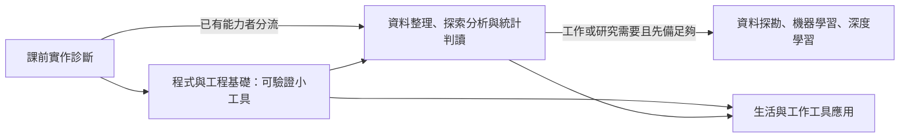

# TA心得：以程式與工程基礎銜接資料分析及模型課程

日期：2026-09-22。來源：Jason本次提供的TA心得及所附分析。延續[idea_000048](raw/idea_000048_ai_software_literacy_for_working_professionals.yaml)，raw／0分未評估、執行parked；本頁補充學習順序，不另建新課程專案。

## 本人倡議與第一原理

Jason主張，針對科技犯罪偵查資通訊專班中缺乏科技與資工先備的執法人員，應先提供基礎程式設計、軟體工程及適量系統工程，再銜接需要程式實作的資料探勘、機器學習與深度學習。他希望開設「程式設計與軟體系統架構概論」，讓學生具備讀碼、修改與指導Codex／Claude Code的能力，自行建立生活及辦案輔助小工具。

稀缺資源是學生課內練習時間、注意力及教師／TA支援。教學成果應是把熟悉的工作需求轉成可理解、可驗證、可維護的工具。本人貢獻為現場問題觀察與課程倡議；「多數缺乏背景」是觀察，尚未量化。所附教學分析保存為建議，不推定逐句皆由Jason撰寫，亦不視為課方決議。

要檢驗的假設是先備能力與教學目標是否匹配：若環境、程式邏輯、資料處理及模型統計四層同時陌生，跟做範例可能無法遷移到新檔案或新錯誤。這是待診斷的教學判斷，尚無本班成效比較。AI的用途、限制與判讀可提早接觸；需寫程式、處理資料、訓練模型的任務則依先備能力安排。

## 能力與學習路徑

| 能力 | 可觀察成果 |
| --- | --- |
| 計算與資料素養 | 指出執行環境、輸入／輸出位置，辨識欄位、型態及格式 |
| 程式基礎 | 解釋條件、迴圈、函式、例外，修改一個條件、欄位或函式 |
| 軟體工程 | 撰寫規格、保存版本、重現錯誤、測試及提供可重現說明 |
| 架構與系統思考 | 說明責任、資料流、來源、權限、人工檢核、停用與交接 |
| AI協作 | 交代目標與限制、小步委派、閱讀差異、依完成條件驗收 |

採實作帶入觀念：在讀檔時談輸入規格，在修改時引入測試與復原。工作循環為「描述問題→規格→小步開發→閱讀修改→測試→人工核對→保存版本」。沿用[A學期草案](2026-09-22-programming-software-systems-course-draft.md)與[B／PRIMM方案](2026-09-22-programming-course-primm-variant.md)，不以新文字覆蓋兩版尚未決定的時數、作業量及評量。

各階段都能產生有用成果，不要求所有人走到模型研究；模型路線另補相應數學、統計與評估能力。AI素養及資料安全貫穿各階段。

## 貫穿案例：虛構事件紀錄

1. 工具階段：整併檔案、驗證時間格式、排序、保留來源檔名與列號；來源檔不覆寫、缺必要欄位明確報錯且不自行補值。
2. 分析階段：計算分布、比較時間區間、說明缺漏對解讀的影響。
3. 模型階段：先問是否需要分群或異常偵測，再定義評估方法；不預設深度學習必然適合。

委派AI時先提供三份合成檔案、欄位與輸出範例、限制及教師確認的測試答案，要求先計畫、小步實作並提交測試結果。學生須能說明改了什麼、為何改、如何相信結果；可用AI及參考資料，仍要具備基本修改能力。程式與測試不能只靠同一AI自我宣告通過。

課堂使用合成或確認適合教學的非敏感資料。正式證據處理另有適用範圍及驗證要求；課堂通過不等於正式採用。[顧同學案例](2026-09-22-police-workflow-tools-teaching-case.md)提供實務需求入口，期限計算仍不作初學者正式判斷工具。

## 診斷、分流與開課取捨

下一測試候選由課方先核定：讓學生執行合成CSV範例、找出輸出、解釋一段函式、修改一項欄位規則並核對已知答案，記錄成功程度、耗時及求助次數。這是建議測試，尚未執行，不替學生評分。

依表現確認需補環境／程式／資料／工程哪一層；已具能力者可由課方決定免修或進階任務，避免只依學歷分流。課方尚須決定診斷標準、免修權限及銜接進階課程的門檻。

優先倡議有學分、TA支援及充分課內實作的正式銜接課；若無法增開，可考慮在既有進階課程之前或同步安排固定基礎實作時段。需要交換部分進階主題時數、配置統一環境與現場除錯支援；不能只增加自學清單或把大量負擔移到下班後。未配置教師、TA、設備、帳號及課內時間前，方案保持待議。

## 給專班的說明草稿（未送出）

> 建議增設「程式設計與軟體系統架構概論」，作為非資訊背景學生的基礎銜接課。依目前TA觀察及同學案例，學生已有具體生活與勤務需求，可透過實作診斷確認程式、資料與工程先備，據此安排讀碼與修改、需求分析、架構、除錯測試、版本管理及基本系統思考。
>
> 課程納入Codex、Claude Code等AI工具，以能說明、能修改、能驗證、能交接的小型工具為成果；再銜接資料整理、探索分析與統計判讀，並依工作或研究需要進入模型課程。課堂使用適合教學的資料，保留來源追溯、資料安全與適用範圍說明。
>
> 考量在職學生勤務負擔，主要練習與除錯安排在課內，提供統一環境及助教支援；具備能力者可依課方診斷分流。請課方先討論正式銜接課或既有課程基礎實作時段的承接方式與資源配置。

## 官方來源與證據界線

2026-09-22新增查核：

- [Stanford CS229](https://cs229.stanford.edu/)當前Summer 2026頁面要求Python／NumPy程式能力、機率、多變量微積分及線性代數。僅用作一門模型課明示先備的例子，不能推為所有ML課共同門檻，也不能直接用來評價本專班學生。
- [Harvard CS50P](https://cs50.harvard.edu/python/)涵蓋無程式經驗者，內容包括讀寫程式、除錯、例外、單元測試與檔案操作。支持把驗證納入入門設計；不表示其作業量適合本班。使用者素材來源標籤寫edX，但此連結實際為Harvard官方課程頁。
- INCOSE、Codex／Claude最佳實務與NIST CFTT沿用[本日官方來源表](2026-09-22-programming-course-official-sources.md)的查核；各自支持系統生命週期、開發驗證機制及工具測試方法，不證明本課成效或完成正式審查。

下一個利害關係人決定：課方確認學習起點診斷與資源承接，再選定課程形式。重用方向：教師討論稿、課前診斷設計與既有A／B方案評估。[課務心得](../../nycu-115-1-coursework/cscm30018/reflections/2026-09-22-working-students-software-literacy.md)保存觀察脈絡；[今日筆記](../../planning-everything-track/weeks/2026-W39/days/2026-09-22.md#foundations-before-models)保存狀態與容量。
