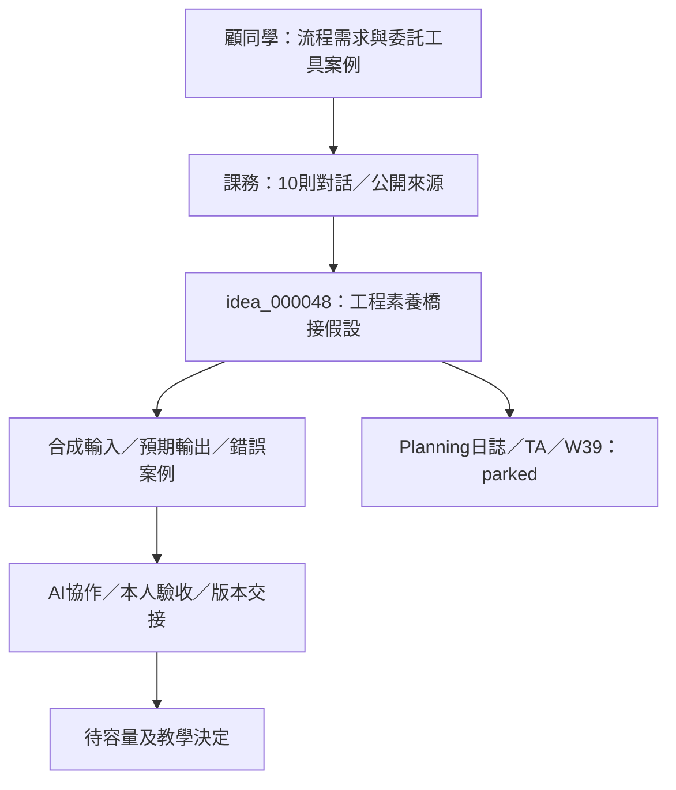

# 警務流程小工具：從TA對話到軟體素養教學案例

2026-09-22；屬[idea_000048](raw/idea_000048_ai_software_literacy_for_working_professionals.yaml)的實務案例補充，raw／未評估，執行parked。[對話與時間線](../../nycu-115-1-coursework/cscm30018/coordination/2026-09-22-gu-workflow-tools/notes.md)由課務持有；[來源查核](../../nycu-115-1-coursework/cscm30018/coordination/2026-09-22-gu-workflow-tools/source-receipt.md)保存本次實際閱讀範圍；本頁持有教學推論與設計選項。

## 核心主張與新增證據

顧同學描述自己熟悉辦案流程、提供資料與需求，請會寫程式的人製作方便小工具。這為[前一份在職初學者心得](2026-09-22-ai-software-literacy-for-working-professionals.md)提供具體案例：學員有領域知識，教學可以把這些知識接到需求規格、程式理解、驗收、維護與交接。這是一名同學的供給案例，不代表全班需求調查或教學效果。

「把資料餵他」不能改寫成「把案件資料上傳AI」；開發者是誰、是否使用AI、資料種類、授權及實際交付方式均未確認。「好用」是使用者評價，並非資安、法律或正確性審查。

## 工具 → 工作問題 → 教學內容

以下工具名及功能取自公開清單與所附分析，教學映射為設計建議；沒有逐一實測。

| 工具 | 工作需求 | 可教的能力 |
| --- | --- | --- |
| 銀行條件CSV匯出 | 將查詢類型、帳號、身分欄位與日期整理成指定格式 | 欄位規格、必填、字串保留前導零、驗證、輸出 |
| 金融帳戶資金流向分析 | 多Excel欄位對應、彙整往來與關係圖 | 清理、分類、加總、資料結構、視覺化 |
| 解送人犯一覽表計算 | 時間資料、規則計算、表單匯出 | 日期與規則建模、例外、測試；實務規則由權責者確認 |
| 對話圖片分割／圖片轉PDF | 長圖、多圖與文件整理 | 批次處理、命名、影像及輸出 |
| 經緯度轉地址／IP查詢 | 批次查詢與結果整理 | 欄位對應、外部服務、資料邊界 |

共同需求可概括為：熟悉工作步驟，希望電腦依規則完成重複輸入、整理、計算與排版。候選定位是「警務工作流程自動化與AI輔助軟體開發」，仍須確認課方與學生的實際需求。

## 三座橋：規格、責任分離、驗收

**規格：**以一份合成輸入、一份正確輸出及數個錯誤例子起步。銀行CSV案例需說明欄位、必填、帳號前導零、可接受日期、空白金額處理及輸出順序；不能由AI自行猜測。

**架構：**用「輸入介面→資料檢查→計算／轉換規則→結果與匯出」理解責任。改按鈕顏色不應影響時間運算，改表格不應改驗證規則。先建立可解釋的邊界，不以檔案數判定架構。

**驗收：**純教學假設中，10:00–11:30與11:00–12:00兩區間若規定重疊只算一次，聯集為2小時；直接加總是2.5小時。這個例子教「先說規則，再驗程式」，不代表任何逮捕、拘留或障礙時間法律計算。跨日／年、無效日期、重複與缺值都是候選邊界案例；規則及法律適用由具權責者確認。

## AI開發助手與跨系統AI分層

用合成資料描述需求→AI協助實作→本人讀碼與測試→經審查的小工具。交付工具可以不含語言模型；AI幫忙寫CSV轉換程式，與每次把資料交給模型推論，是不同資料流。

| 層次 | 討論範圍 | 確認關 |
| --- | --- | --- |
| 個人工作輔助 | 經允許的檔案整理、計算、匯出 | 輸入範圍、預期結果、資料流與清除 |
| 單位共同使用 | 共用版本、文件、維護、交接 | owner、更新／還原、保存與支援責任 |
| 跨系統AI | 多系統資料與動作協作 | 逐系統權限、規範、操作核准及紀錄 |

這是課程範圍分類，不是對現有警政系統的調查結論。入門可聚焦第一層、帶到第二層；資料是否可交給開發者或AI仍需各自確認。

## 「線下」的四個獨立問題

1. **執行位置：**GitHub Pages是靜態網站託管；有網址不等於案件計算一定在遠端。解送頁自述本機運算；本次只做HTML／內嵌程式閱讀。
2. **外部依賴與網路：**本機計算仍可有外部字型、套件或服務。作品集確實載入Google Fonts及工具JSON，但不能把作品集的依賴套用到各工具。離線驗收候選需在乾淨環境斷網測試首次開啟、匯入、計算、匯出；本次未執行。
3. **保存與清除：**解送頁提醒本機暫存／公用電腦清除；程式有localStorage讀寫與清除函式。localStorage可跨工作階段保留，不能以關分頁等同清除。可另查匯出檔、下載位置及備份；本次未證明清除完整性。
4. **使用範圍與存取權：**同學自述僅單位使用；兩頁目前可HTTP公開讀取。公開程式不是公開案件資料，沒有證據宣稱資料外洩，也不能因此確認單位專屬存取。

一般技術原理與官方來源逐項收在[查核回執](../../nycu-115-1-coursework/cscm30018/coordination/2026-09-22-gu-workflow-tools/source-receipt.md)；公開清單的法律正確性、精確計算或符合規定說法不作本次背書。

## 六模組：把十週輪廓接到一個小專題

這是[十週候選輪廓](2026-09-22-ai-software-literacy-for-working-professionals.md)的能力歸納，不另新增六週課或平行課程。

| 模組 | 核心能力 | 可檢查產出 |
| --- | --- | --- |
| 需求與流程拆解 | 誰用、輸入、處理、輸出 | 一頁規格與流程 |
| 資料與程式基礎 | 字串／數字／日期、條件、迴圈、函式、CSV／JSON | 讀懂並修改小處理程式 |
| AI協作 | 範例、分段委派、錯誤重現、限制改動 | 一項功能的修改與驗證證據 |
| 小型架構 | 介面、驗證、規則、匯出分責 | 指出某項需求應改哪部分 |
| 測試與資料安全 | 正常／邊界案例、資料流、保存／清除 | 測試集與資料處理說明 |
| 版本與交付 | Git、diff、文件、更新／還原 | 他人能依說明操作的作品 |

安全與驗收從第一次選資料、套件及工具權限開始。依所附分析的風險排序，先選合成CSV、檔案整理或圖片分割；人身自由相關期限計算保留為進階規則與測試討論。這不是判定現有工具算錯，而是明確界定初學作品的採用條件。

期末候選驗收問題：解決何事？哪些資料可輸入？錯誤如何處理？如何知道結果正確？資料在哪保存？下一人能否操作、修改及還原？具體課程與評分仍待教師決定。

## 最小測試與下一個決定

尚未排程：待教師、學員與Jason確認容量，選一個合成CSV格式轉換例子，要求學員先交輸入、預期輸出、前導零／缺值／日期的錯誤案例；AI協助實作後，學員指出責任位置、重現一個錯誤並保存修正測試。觀察卡點、提示次數、正確性及是否能重新執行，再決定需要既有課、橋接單元或新課。

沒有安排正式系統整合、稽核、工具維護或對外提案。[回覆草稿](../../nycu-115-1-coursework/cscm30018/coordination/2026-09-22-gu-workflow-tools/reply-draft.md)仍待Jason確認，不能當成已送出的訊息。

[TA原心得](../../nycu-115-1-coursework/cscm30018/reflections/2026-09-22-working-students-software-literacy.md) · [9/22紀錄](../../planning-everything-track/weeks/2026-W39/days/2026-09-22.md#gu-workflow-tools-2026-09-22) · [工程手冊Module 11](../../ai-systems-engineering-handbook/modules/11-spec-sdd-ai-coding-workflow/README.md)。工程手冊供概念查找，不新增在職學員先備要求。

## 完整學期候選：程式設計與軟體系統架構概論

[最新18週草案](2026-09-22-programming-software-systems-course-draft.md) · [官方查核](2026-09-22-programming-course-official-sources.md)：3學分／每週3節、四層能力、模擬CSV專案、40／20／30／10評量及四次試教建議。原短版與六模組保留為設計比較；全部沿用idea_000048，未核定／未排程，不重複增加課程或容量。
