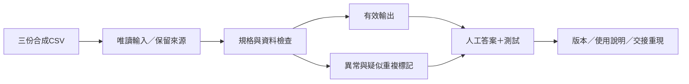

# 程式設計與軟體系統架構概論：完整學期課程草案

副標：**以 AI 協作開發生活與偵查輔助工具**。

整理日：2026-09-22。對象：資訊學院科技犯罪偵查資通訊碩士在職專班中，具執法經驗、程式與資工先備有限的學生。狀態：Jason倡議與所附設計建議之完整紀錄，校方未核定、未對外送件、未排定試教。延續[idea_000048](raw/idea_000048_ai_software_literacy_for_working_professionals.yaml)，raw、0/100尚未評估，執行parked。

## 本人主張與來源層次

Jason希望專班開設「程式設計與軟體系統架構概論」，讓同學具有基礎程式碼閱讀能力，能指導Codex、Claude Code等工具寫程式，結合軟體／系統工程架構理解，自行完成生活與辦案輔助小工具。

「多數沒有學過科技與資工知識」保留為Jason的現場觀察，尚未量化班級分布。官方[專班定位](https://exam.nycu.edu.tw/mas-crime.html)支持系統性資通訊教育及學術與實務結合；完整查核見[來源表](2026-09-22-programming-course-official-sources.md)。本次所附詳細教學建議的逐句作者未另確認，記為供給草案，而非Jason已驗證的教學結果。

## 課程定位與可檢查成果

本課程面向無程式設計與資訊工程基礎的在職執法人員，結合基礎程式閱讀、運算思維、軟體工程、軟體系統架構與AI協作開發。透過生活及模擬偵查情境，學習辨識可自動化工作、撰寫規格、理解程式結構，逐步完成可測試、可說明、可修改與可交接的小型軟體。

希望建立的能力依序連接：**定義問題→閱讀程式→指導開發→檢查結果→維護與交接**。合理設計是把必要練習、除錯、複習放入課內，縮小作品範圍；「一學期成為軟體工程師」及「完全不練習也能學會」不作成果承諾。

## 四個相互連接的能力層次

| 能力層 | 教學內容 | 學生要能解釋／完成 |
| --- | --- | --- |
| 運算環境 | 程式碼、資料、執行中的process、輸出；檔案／路徑、編輯器、終端機、套件、環境 | 現在在哪個資料夾、指令執行哪個檔、讀什麼、輸出在哪、是否覆寫來源 |
| 讀碼與小改 | 變數、型態、條件、迴圈、函式、I/O、例外 | 用自己的話說明短程式的輸入、規則、輸出與至少一種失敗；能改欄位／篩選或明確報錯 |
| 軟體工程與架構 | 需求、功能、模組責任、介面、資料流、版本、測試、維護 | 哪部分負責什麼、何處改外部狀態、修改會影響哪裡；不讓報表功能偷偷改來源資料 |
| 整體工作系統 | 人、流程、資料、權限、設備、驗證、更新、停用與退場 | 誰提供資料／執行／審查、出錯如何停止、誰重驗新版、開發者調職後誰維護 |

案件編號`001234`轉成`1234`可作資料表示錯誤例子：關鍵不是外觀，而是需求要求識別碼保留前導零。允許查資料及AI協助，但學生需能說明理由與結果。

本次明確補正前期簡化：架構不只是拆成幾個檔案，系統工程也不只是把前後端／資料庫接起來。小工具可以從第一天採整體思考；專業標準與複雜建模語言依需求逐步增加。[INCOSE](https://www.incose.org/about-systems-engineering/)支持組件關係、整合與全生命週期觀點。

## 時數方案與前期構想關係

最新完整學期候選：**3學分、18週、每週3節**；每次約三分之二留給操作、除錯與個別指導。學分、節長及實際課表待校方；不可自行把54節當成54個鐘點。採Python主語言、一套共用環境、一個貫穿學期專案；AI工具先熟悉一種，再示範方法遷移到另一種。

若僅能開2學分，保留讀碼、需求、AI協作、Git及測試，成果限於單機資料處理。資料庫、完整網頁前後端、雲端、手機App、多代理系統不列為本方案必修交付。

[原8–10週構想](2026-09-22-ai-software-literacy-for-working-professionals.md)保留為較短替代方案；[六模組案例](2026-09-22-police-workflow-tools-teaching-case.md)是能力地圖。這份18週版是本次最新完整候選，三者不累加成三門課。課外15–20分鐘取代本版設計中的30–60分鐘假設，仍非學生可用時間的實測。

## 十八週候選進度

| 週次 | 核心問題與內容 | 課內可驗收成果 |
| --- | --- | --- |
| 1–2 | 程式執行；檔案、路徑、終端機、Python、資料安全；第一個版本 | 執行範例、指出輸入輸出、不覆寫來源 |
| 3–4 | 讀碼與修改；變數、型態、條件、迴圈、函式、例外 | 解釋短程式、預測結果、完成小改 |
| 5–6 | 工作問題轉規格；輸入輸出、規則、限制、驗收 | 一頁需求與人工確認的範例答案 |
| 7–8 | 模組責任、介面、資料流、套件依賴 | 說明工具結構，適度分離讀取／處理／輸出 |
| 9–10 | 指導Codex／Claude Code；規劃、小步改、diff、測試 | 一次有計畫、版本紀錄與測試的功能變更 |
| 11–12 | 除錯、正常／邊界與回歸測試 | 找到教師預埋錯誤，修正且檢查既有功能 |
| 13–14 | 工具進入工作流程；本機／雲端、權限、資料來源、紀錄、交接 | 系統邊界與資料流，列明停止使用條件 |
| 15–16 | 共用範例改為生活或模擬勤務需求 | 受控小專案與使用說明 |
| 17–18 | 他人重現、新需求修改 | 同學依說明執行；本人完成指定小改與口頭解釋 |

週次代表主要焦點；安全、版本與結果檢查從第一次操作開始，不延後到表列週次才出現。

## 貫穿專案：模擬資料整併與異常檢核工具

起始只讀一份教學CSV，顯示筆數與欄位；後續加入多檔整併、欄位檢查、異常標記、來源追溯、測試與說明。三份完全虛構事件資料作共同教材，無需先學複雜鑑識。

候選規格：

- 識別編號以字串保留前導零。
- 無法解析日期時列異常，不猜測。
- 疑似重複先標記，不直接刪除。
- 每筆輸出保留來源檔名與來源列號。
- 結果寫到另一個資料夾，不覆寫來源。

教師預備獨立確認答案：例如100筆中95筆格式有效、5筆錯誤；這是設計例子，目前沒有資料集或驗收結果。檢查全部100筆是否都有交代，不只檢查是否產生檔案。筆數一致也只是必要檢查，仍須核對分類、內容與追溯欄位。

後半期可由共同結構調整為生活收支、公開資料、檔案清冊或合成事件時間軸，降低每位學生從空白啟動的負擔。



## AI協作流程與課堂任務範本

循環：需求與限制→AI提出計畫→本人確認→只改一小部分→看diff→執行測試→人工核對關鍵結果→保存可回復版本。學生要在規劃、審查與驗收位置；工具讀寫／命令能力及驗證建議由[官方查核表](2026-09-22-programming-course-official-sources.md)承接。

以下保留使用者提供的教學任務範本，屬課堂素材，不是本次授權執行的開發任務：

```text
目標：
為教學用 CSV 整併工具增加「缺少必要欄位」的檢查。

請先閱讀現有程式與測試，只提出修改計畫，暫時不要改檔。

限制：
不得修改來源資料。
不得新增外部服務或上傳資料。
不得順便重寫與本次需求無關的功能。
需要安裝新套件時，先說明理由並取得確認。

驗收：
正常檔案維持原本結果。
缺少必要欄位時，清楚指出檔名與缺少的欄位。
既有測試必須通過。

完成後：
列出修改的檔案、測試結果、尚未驗證的情況，
並用初學者能理解的方式解釋主要修改。
```

長期專案規則可用Codex的`AGENTS.md`或Claude Code的`CLAUDE.md`保存。指示文件交代協作規則，安全邊界另由權限、沙箱與人工核准實現；本次沒有新增或修改任何代理設定。開課前按實際版本與環境確認操作，不把同一工具的文件當作另一工具的證據。

## 執法人員版本的三個採用條件

**開發與資料處理分開。**課堂只用合成或經確認可供教學的公開資料，不帶入卷證、個資、帳密或機關內部資料。本機安裝的AI開發代理仍可能連網；Claude官方資料使用頁明確說明模型互動會經網路。第一階段候選是用AI協助寫一般程式，完成的工具不需呼叫AI且可離線執行；離線必須另行實測，正式資料採用依機關設備、資安與核准程序。

**課堂作品、勤務輔助、證據處理分開驗收。**課堂通過只適用已測教學情境。交付需記錄資料來源、程式版本、參數、規則、限制；涉及正式證據另確認適用範圍、驗證與機關程序。NIST CFTT以明確規格及測試方法檢查能力，作為驗收觀點的參考，不是本課作品的認證。

**答案不能完全由同一AI決定。**AI可協助寫測試，教師需獨立確認測試資料與預期答案，學生人工核對關鍵結果。資料不被不明刪除、規則可解釋、錯誤可停止或明確告警，優先於功能數與畫面美觀。

## 零基礎教學節奏、評量與支援

每次課：短練習喚回→教師示範完整例子→學生改一小處→獨立做相似變化。下課留下「目前能做什麼／還有什麼錯誤／下次從哪裡繼續」三項紀錄，支援勤務中斷後恢復。

課後候選15–20分鐘重開專案或小改；不以回家另花五小時為隱含前提。完全沒有課外時間者，需課內補做或縮小作品，不能保證沒有練習也會熟練。

| 評量項目 | 建議占比 | 主要證據 |
| --- | --- | --- |
| 課內實作 | 40% | 本人操作與小步結果 |
| 個人讀碼與小修改 | 20% | 解釋輸入／規則／輸出，完成指定變更 |
| 期末工具與測試 | 30% | 規格、獨立答案、正常／邊界／回歸結果 |
| 文件與交接重現 | 10% | 他人按說明執行、版本與還原 |

合計100%，均為建議。關鍵個人驗收：教師給一個小變更，學生可查資料、可用AI，但須自行操作、解釋理由並提出驗證結果。安全／追溯列為候選及格要求，具體門檻及補救由授課團隊決定。

師資包括講授、現場環境／除錯／讀碼支援TA及執法情境提供者。共同環境、軟體、帳號、使用額度、費用與教學資料須事先準備；目前未指定Jason授課或增加其TA責任，也未配置預算。

## 向專班提出的文字草稿（未寄送）

> 建議本專班增設「程式設計與軟體系統架構概論——以 AI 協作開發生活與偵查輔助工具」課程，作為非資訊背景執法人員的基礎能力銜接課程。
>
> 課程協助學生建立程式碼閱讀、需求分析、軟體結構理解、AI協作開發、除錯測試、版本管理與資料安全等能力。透過生活及模擬偵查情境，讓學生在可理解、可驗證與可控管的條件下，自行開發小型工具。
>
> 考量在職學生勤務繁重，建議以課內實作為主，提供統一環境、循序教材、專案範本及助教支援，以「能說明、能修改、能驗證、能交接」作為主要學習成果。詳細學分、時數、評量及師資配置待專班討論確認。

此段依所附文字整理，目標是爭取足夠的實作支援，未代表校方核定或Jason對外承諾。

## 下一個驗證：四次試教候選

使用者所附分析建議先以本專案試教四次，再調整18週進度與TA配置。尚未排程；啟動前確認課方owner、學生意願／背景、教學時段、師資與容量、設備與帳號，以及可接受的資料。

試教的核心觀察：學生在教師未代操作時，能否讀懂、修改並驗證一個小功能。記錄首次成功時間、提示與代操作次數、錯誤類型、下一次重開能力及TA支援負擔。若主要時間消耗在環境，先改環境；若能生成但不能驗收，收斂測試／讀碼；若仍需大量課外支援，縮小範圍或增加課內支持。具體四次分配與通過門檻待教師共訂，不自動排入本週。

## 強連結與版本路徑

[TA本人心得](../../nycu-115-1-coursework/cscm30018/reflections/2026-09-22-working-students-software-literacy.md) → [顧同學工具案例](2026-09-22-police-workflow-tools-teaching-case.md) → [原短版](2026-09-22-ai-software-literacy-for-working-professionals.md) → 本18週候選 → [來源查核](2026-09-22-programming-course-official-sources.md)。全部沿用同一idea_000048，沒有新增平行專案。

[今日紀錄](../../planning-everything-track/weeks/2026-W39/days/2026-09-22.md#programming-course-draft-2026-09-22) · [W39](../../planning-everything-track/weeks/2026-W39/weekly-plan.md#programming-course-draft-2026-09-22) · [TA狀態](../../planning-everything-track/data/projects/2026-09-cscm30018-teaching-assistant.md#programming-course-draft-2026-09-22) · [工程手冊Module 11](../../ai-systems-engineering-handbook/modules/11-spec-sdd-ai-coding-workflow/README.md)。

FIRST PRINCIPLE：稀缺資源是課內有效練習、現場支援、注意力與可採用資料。Brainstorming持有設計比較與驗證假設；課務持有現場觀察與課方證據；Planning持有容量、狀態與下一關。本次只記錄／查核，不新增開課、四次試教、招生、正式系統操作或研究執行。


<a id="course-primm-variant-2026-09-22"></a>

## 後續B候選：PRIMM與不同負擔／評量

[B完整筆記與A／B比較](2026-09-22-programming-course-primm-variant.md)保留本次新增方案；本頁A的「最新」屬前次收件時點。B的3小時、課外1–2小時、20／20／40／20評量及無AI即時代答不可默認覆蓋A；兩案皆待教師、學員容量與正式安排確認。


<a id="foundations-before-models"></a>

## 基礎銜接與模型課程的先備

[完整心得、診斷與來源](2026-09-22-foundations-before-model-courses.md)補充「小工具→資料分析／統計→按需求進入模型」路徑；新增查核Stanford CS229與Harvard CS50P。AI素養可提早教；課前實作診斷與分流、正式學分課或基礎實作時段均為待議方案，A／B條件保留。
