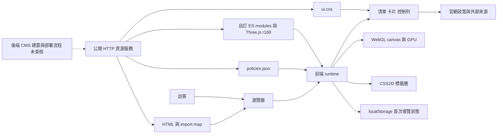
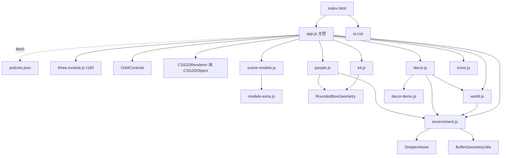
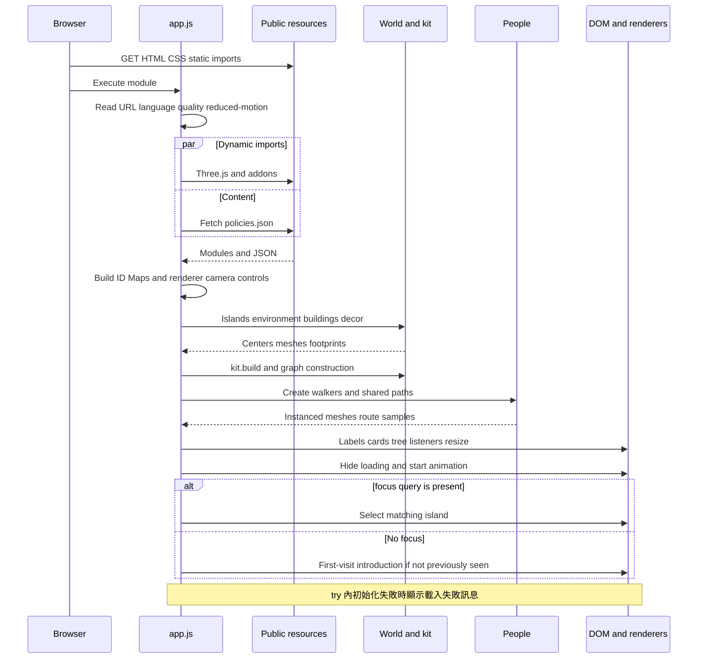
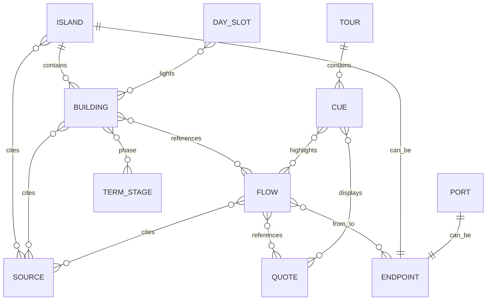
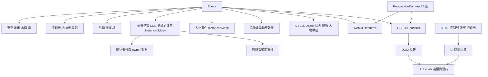
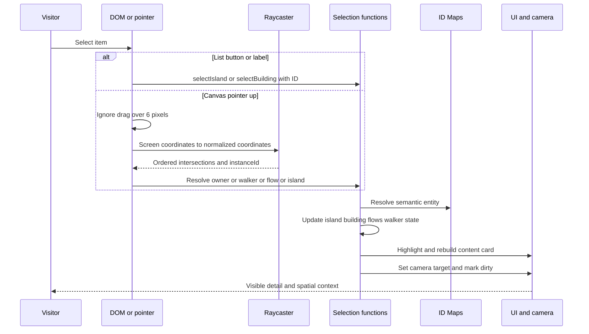
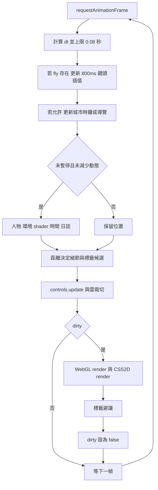
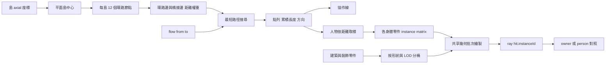

# 原站完整前端架構

返回[閱讀入口](README.md)。範圍：2026-10-22 公開載入的前端與資料；所有行號對應 [manifest](source-manifest.json) 所列 bytes。[程式定位表](source-map.md)提供查找起點。

## 1. 系統邊界：瀏覽器如何取得一座城

瀏覽器下載 HTML、樣式、JavaScript 與 JSON。JavaScript 根據資料生成 3D 物件，WebGL 交給 GPU 繪製；文章清單與細節卡則是 DOM。政策外連只是在使用者選擇後開啟原始內容來源。

定位：`index.html` 的 base、script、stylesheet；`app.js` L35–86、L2173–2177。本圖描述可見邊界，不主張主機商或整個網站的後端實作。

## 2. 模組依賴：哪些程式彼此合作

下圖實線表示 import；資料載入另以虛線表示。十個自訂 JS 檔完整列入，不把 Three.js 的每個 vendor 內部類別展開成應用模組。

| 模組 | 主要輸入 → 輸出 | 責任與耦合 |
| --- | --- | --- |
| `app.js` | URL、DOM、JSON、各模組 → 可操作網站 | 建立 Maps、場景、選取、卡片、篩選、時鐘與導覽；2177 行，UI 與渲染協調集中 |
| `world.js` | 島嶼 axial、建物、樣式 → centers、neighbors、islandViews、bridges、步行 graph | 幾何布局與實際可走路徑；TOP 為平面共同高度 |
| `kit.js` | shape、位置、比例、顏色、owner → 批次記錄與 InstancedMesh | 幾何共用、材質、LOD 分桶、owner 到 instance 對照 |
| `scene-models.js` | 政策 ID、模型種類、零件 helper → 幾何零件 | `sceneSpecs` 將語意 ID 對到模型；`createPolicyModel` 產生建構函式 |
| `models-extra.js` | 模型 kind 與 helper → 額外模型零件 | 擴充建築與具象場景，不是遠端模型服務 |
| `environment.js` | 品質、城市中心、時間 → 天空、水面、地形、燈光與 update | seeded noise、shader、日夜 keyframes、雲移動與距離裁切 |
| `decor.js` | 邊界、鄰接、建物 footprints、地形高度 → 裝飾、ambientSpots 等 | 橋邊與水域敘事、避開建物、渡船曲線等 |
| `decor-items.js` | kit 與位置 → 各主題邊緣小景 | 用小道具增加各島辨識度 |
| `people.js` | graph、flows、paths、島中心、品質 → 人物 meshes 與更新函式 | 行走、角色、攜帶物、路徑快取、instance 到人物對照 |
| `icons.js` | 主題 ID → SVG 字串與色彩常數 | 用於 DOM 介面 |

## 3. 啟動時序：資料到第一張畫面

定位：`app.js` L1–95、L272–434、L1241–1296、L2160–2177。最上方靜態 imports 發生於模組求值前，不能假定所有網路失敗都會被底部 `catch` 接住。資料 Map 建立不等於 JSON schema 已驗證。

## 4. 資料關係：語意內容如何綁定場景

`ENDPOINT`、`DAY_SLOT`、`TERM_STAGE` 是本圖說明用名稱，不是宣稱 JSON 有同名根節點。from／to 是陣列，因此一個 flow 可能展開成多條線，**20 組 flow 不等於 20 條實際線段**。

| 實際欄位 | 內容與用途 |
| --- | --- |
| `islands[]` | id、number、name、summary、HEART、axial／cells、sources、buildings 等；14 組 |
| `buildings[]` | id、name、facts、plain、who、status、phase、flows、sources；合計 94 |
| `sources[]` | id、URL、title、checkedAt、status、confidence；18 組 |
| `ports[]` | 島外關係端點，不是政策島；3 組 |
| `flows[]` | from／to、carry、walker、text、evidenceTier、sources、quotes、excludedEdges、edgeNotes 等；20 組 |
| `quotes[]` | 文字、節目、timecode、URL、verification、readyToPublish 等；3 組 |
| `dayCycle[]` | 時段、要亮起的建物 ID、情境與時間意義；8 組 |
| `termTimeline[]` | 5 個任期時間階段，供細項時程顯示 |
| `tour` | 78 秒 storyboard、11 個 cue；程式有播放路徑，入口可達性未完整測試 |
| `schemaVersion`、`meta`、`termRules`、`renderPlan`、`ui` | 存在於資料；本次未見自訂模組直接以 `D.<欄位>` 讀取，不可直接當成 runtime 控制值 |

例如 `renderPlan.walkers=60` 只是資料欄位，不能據此宣稱畫面恆有 60 人；應追 `people.js` 的實際產生邏輯。`tour.status=storyboard_only` 也不是自動停止播放的程式 gate。資料註記與執行行為必須分別核對。

## 5. 場景結構：3D 與文字的分工

這是責任圖，不表示每棟建物都是獨立 `Group`。原站將不同建物的同類零件合併在 batch，靠 owner／instance index 找回語意。CSS2D 位置取自 3D 座標，但文字仍是 HTML；它不會自動具備正確的遮擋、鍵盤順序或無障礙語意。

## 6. 互動時序與選取狀態

原站狀態分散在 `selectedIsland`、`selectedBuilding`、`selectedFlows`、`selectedHeart`、`selectedWalker`、`mode`、`treeMode`、`fly`、`tourActive` 等變數。圖表示共同協調路徑，並非它使用狀態機套件。關閉卡片與清除選取是不同操作，需讀 `home()` 與各 close handler 才能知道效果。

實測：清單「交通」→「通學區」→「F6」分別顯示主題卡、細項卡與協作來源卡。搜尋 `YouBike` 後顯示交通 1 個結果。這些測到 DOM 路徑；canvas ray picking 僅完成程式靜態追查。

## 7. 逐幀更新：畫面如何持續變化

動畫以瀏覽器 frame timestamp 為時間基準。城市時鐘每真實秒前進 10 分鐘，理想連續更新時一天約 144 秒；背景節流、dt 截斷與暫停會改變牆鐘時間。`dirty` 可省掉部分 render，但 RAF 回呼仍持續排程，不能宣稱暫停後 CPU 為零。定位：`app.js` L1936–2053。

## 8. 人物路網與批次繪製

`world.js` L564–649 是距離加權圖與以線性掃描選最小距離節點的 Dijkstra 型實作；沒有 A* heuristic。`people.js` L279–337 快取路徑、計算累積長度，線與對應行人共用路線。這支路網的方向計算將 y 歸零，適合平面步行；我們的懸浮航線要使用完整 3D 向量。

## 如何讀這八張圖

先沿啟動時序圖走一次，再挑一個具體細項，從資料 ID 找到模型、batch owner、點擊與卡片。讀懂一條完整路徑後，再看天空 shader 或裝飾細節。這樣能把資料、程式與實際畫面對起來。
