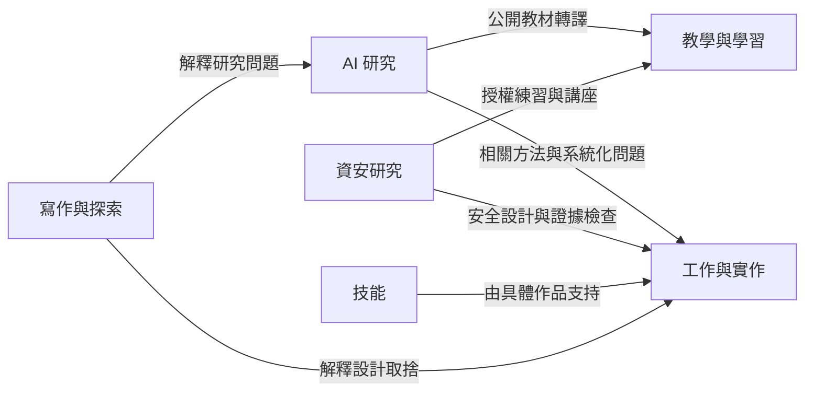

# 首頁與懸浮六島設計

返回[閱讀入口](README.md)。以下是已採納方向下的具體設計提案；畫面尚未實作，內容候選尚未完成發布前時效校對。

## 訪客先完成什麼事

| 訪客 | 主要問題 | 最短路徑 |
| --- | --- | --- |
| 第一次認識 Jason | 你關注什麼、能在哪裡合作？ | 首頁簡介 → 主題 → 一項成果 |
| 研究合作與評審 | 問題、方法、證據與狀態是什麼？ | 代表研究 → 詳細頁 → 證據來源 |
| 工程合作或招募 | 你做了哪一部分、實際交付到哪裡？ | 工作與實作 → 角色與輸出 → 履歷 |
| 學習者 | 有什麼能跟著學？ | 教學與學習 → Kairos 或既有教學頁 |
| 喜歡探索的訪客 | 這些領域如何相連？ | 群島 → 一座島 → 代表作品與關係 |

首屏不要求訪客先理解所有專案縮寫；每個入口用一個可理解問題加一個具體成果。群島的目的，是幫助認識工作的結構，文字閱讀仍可直接完成任務。

## 首頁參考如何轉成自己的設計

實際查看 [Kairos Learning](https://learn.cs-kairos.com/)後，可辨識暖白底、閱讀導向排版、章節編號、重點課程、主題入口與開始方式。CSS 宣告 `#fbfaf7` 背景、`#24211d` 文字、`#6f3f2d` 強調色、70rem 外框及 17px/1.85 內文。這些是本次 source snapshot 的值。

Notion 教材的可重用部分是「頁首先給結論與狀態 → 選入口 → 依層次展開 → 結果與來源 → 下一步」。私人工作區不是公開網站的資料庫，也不直接複製其工作紀錄。

| 原參考結構 | 首頁採用方式 | 轉換理由 |
| --- | --- | --- |
| 先說學習目的 | 簡介與關注問題 | 訪客先知道內容與自己是否相關 |
| 一個主課程入口 | 三項代表成果 | 讓重要輸出可直接進入 |
| 探索主題 | 六個固定主題 | 與 3D 島嶼保持一致分類 |
| 按步驟深入 | 首頁摘要 → 作品卡 → 完整文章 | 避免首頁變成完整履歷或長報告 |
| 版本與日期 | 成果狀態與更新日期 | 避免把歷史工作誤讀為最新進度 |
| 詳細頁目錄 | 長文章保留目錄 | 首頁本身不增加重型側邊工作區 |

## 首頁線框與元件規格

```text
桌面：內容外框最大 1120px；內文段落最大 720px
┌──────────────────────────────────────────────────────────┐
│ Jason Lin        Research  Systems  Learning  Writing  CV │
├──────────────────────────────────────────────────────────┤
│ 研究與實作                                               │
│ 姓名 + 一句說明關注的真實問題                             │
│ 兩句摘要；近期狀態有明確日期                              │
│ [閱讀代表成果]  [探索懸浮群島]                            │
├──────────────────────────────────────────────────────────┤
│ 01 代表成果：研究／系統／教學                             │
│ 標題 → 貢獻 → 成果狀態 → 連結                            │
├──────────────────────────────────────────────────────────┤
│ 02 依主題閱讀：AI  資安  工作  技能  教學  寫作           │
├──────────────────────────────────────────────────────────┤
│ 03 群島靜態預覽                  [進入 3D 探索]          │
├──────────────────────────────────────────────────────────┤
│ 04 最近公開筆記與課程：日期、標題、短摘要                 │
├──────────────────────────────────────────────────────────┤
│ About／CV／公開聯絡方式／更新日期                         │
└──────────────────────────────────────────────────────────┘

手機：單欄，左右 20px；標題不超過三行
[姓名與簡短導覽]
[一句定位／摘要]
[代表成果按鈕] [群島入口]
[代表成果 1]
[代表成果 2]
[代表成果 3]
[六主題，每列一至兩個]
[靜態群島預覽]
[最近文章與課程]
[履歷與聯絡]
```

視覺預設：首頁沿用 Kairos 暖白色系；一般文字 17px、行高 1.75–1.85，輔助文字至少 14px；h1 使用 `clamp(2rem, 4vw, 3.25rem)`，章節間距桌面 64px、手機 40px。卡片邊框 1px、圓角 12px，重點靠排版與色彩而非大面積陰影。互動目標至少 44×44 CSS px，focus-visible 保留 3px 明顯外框。

代表成果先選 CDS-ASR／JANUS、Project AURA、7-day Enterprise AI 教學三個候選，因為能展示研究、工程與轉譯三種貢獻。正式短文與狀態取自既有頁面，在內容校對階段確認；沒有近期證據時使用確切歷史日期，不使用「最近 90 天」。

首頁只顯示三筆最近公開文章，按可核對的發布日期排序；修改日期不自動當成新成果日期。研究與系統頁面繼續使用原路徑；首頁重設不啟動刪頁或 URL 遷移。

## 群島的空間構圖

視覺方向：奇幻微縮，將「懸浮岩島、植物與雲霧」轉成可自行建構的形狀語言。採高低錯落、不規則輪廓；六島不拼真實地圖。島的高度、大小與顏色表達構圖與類別，不代表能力排名或證據強度。

初始構圖採右手座標、Y 向上。預設位置是設計起點，碰撞與實際構圖測試若發現問題，須記錄調整。

| ID／島嶼 | 位置 x,y,z | 尺寸與輪廓 | 主色／地標 | 對應內容 |
| --- | --- | --- | --- | --- |
| `ai` AI 研究島 | −6, 3, −4 | 半徑約 2.8；分層岩台 | 青藍；觀測塔、資料晶體、溫室 | 語音決策穩定、證據封包、AI 治理 |
| `security` 資安研究島 | 5, 4, −5 | 半徑約 2.6；環形外緣 | 靛藍；環形堡壘、訊號塔、檢核閘門 | AI 安全、醫療資安、聯邦學習洩漏 |
| `work` 工作與實作島 | 7, 1, 3 | 半徑約 3.0；分段平台 | 陶土橘；工坊、部署碼頭、測試台 | AURA、UroPrevisit、AI Triage 等公開原型 |
| `skills` 技能島 | 0, 0, 7 | 半徑約 2.5；模組化梯田 | 琥珀；工具棚、拼接平台、三座小橋 | 語音管線、AI 系統、威脅建模等能力與作品連結 |
| `learning` 教學與學習島 | −7, 2, 4 | 半徑約 2.7；開放階梯 | 苔綠；書院、教室、露天閱讀區 | Kairos、7-day 教材、公開講座 |
| `writing` 寫作與探索島 | 0, 6, −9 | 半徑約 2.4；細長觀景台 | 紫灰；書庫、庭園、望遠鏡 | 已公開文章、介面設計與研究觀察 |

岩體厚度約 2–3 世界單位，底部漸尖；每島 1 個主地標與最多 3 個可選內容入口。每個入口的標籤同時有名稱與主題，不只用顏色。選取輪廓以暖白光圈或邊緣色表達；尚無公開內容的入口呈明確說明，不做無回應假連結。

初始相機暫定 `(20,18,26)`，目標 `(0,2,0)`，FOV 40°，near 0.1、far 150；最終需用群島邊界和畫面安全區計算 fit，手機不能沿用固定距離裁掉島嶼。相機角度限制在看得到島頂與部分岩壁的範圍，避免從底部翻轉。完整公式與邊界見工程規格。

浮動使用每島不同 phase 的小振幅正弦波：振幅 0.08–0.15 世界單位、週期 8–14 秒。標籤、點選 proxy 與地標跟隨同一 parent。停用動態時凍結到穩定基準，不要求使用者追逐移動目標。

## 內容映射：各島要讓人看見什麼

下列是本機網站資料中存在的候選，存在不等於本輪重新驗證其研究結果或正式發布狀態。

| 島 | 首批內容候選 | 內容呈現規則 |
| --- | --- | --- |
| AI | CDS-ASR／JANUS；provenance-bounded evidence packets；false-governability runtime governance | 說明問題與方法，論文狀態照原頁，不能把 draft 稱為已發表 |
| 資安 | Federated Learning Leakage Study；Security Evidence／CaseTrace；CYBERSEC 2026 醫療資安內容 | 用公開研究、聚合結果與講座；私人案件與漏洞細節不入頁 |
| 工作 | Project AURA；UroPrevisit Navigator；AI Triage Kiosk Demo | 明列 Jason 貢獻、輸出及 prototype／驗證範圍；不代稱為商用部署 |
| 技能 | 語音與資料管線 → AURA；AI 系統整合 → 7-day 教材；安全設計 → CYBERSEC 內容 | 技能是閱讀分類，點開後必須有實際作品；不列自評 95% |
| 教學 | Kairos MATLAB 課程；Enterprise AI Architecture Sprint；公開講座索引 | 外站明示目的地；保留教材、講授與學習完成的區別 |
| 寫作 | Speech Evidence Pipelines；Investigation and Trustworthy AI；Flat UI to Spatial Interface | 以公開文章為準，私人反思與日誌不混入 |

同一作品可出現在不同島的關聯清單，但只有一份 canonical 內容。AURA 在工作島有主模型，技能島只連回它；不要複製兩份日期、介紹與狀態。

## 關係線要說清楚哪一種連結



這張圖是導覽分類提案，不聲稱每對領域有已驗證的因果或技術繼承關係。實作每條 item-level 線時，以文章中可找到的具體關係填入說明；欠缺依據則省略。全景不顯示全部線，聚焦後最多顯示該項最相關的四條。

## 探索流程與版面

```text
桌面 /islands/
┌──────────────────────────────────────────────┬─────────────┐
│ 返回首頁   全景   動態開關   文字清單          │ 搜尋／六主題 │
│                                              │             │
│      高低錯落的六座懸浮島                    │ 選取名稱     │
│      全景只顯示六個島名                      │ 一句問題     │
│      選取後顯示相關地標與航線                │ 貢獻與狀態   │
│                                              │ [閱讀全文]   │
└──────────────────────────────────────────────┴─────────────┘

手機 /islands/
[返回首頁] [全景] [清單]
[3D 畫面，保留足夠可點區域]
[單一底部面板：清單 或 島摘要 或 作品卡]
[面板返回／關閉] [可擴大閱讀]
```

桌面側欄寬 360px；小於 800px 改手機布局。手機面板三種內容互斥，清單開啟時不疊作品卡。詳情閱讀可以展開至視窗高度約 85%，內部可捲動；場景仍保留回全景入口。關閉面板恢復發起操作的焦點。

選島先給一句主題說明與代表內容；選作品顯示問題、Jason 的貢獻、成果狀態、最多三個證據／文章連結。全文留在既有 HTML 頁面，以一般 `<a>` 進入，瀏覽器返回可回到群島焦點。

空白搜尋顯示所有可公開項目；無結果顯示可清除搜尋的明確訊息。搜尋命中作品時同時告訴訪客它在哪座島。低動態、WebGL 失敗與文字模式均可完成尋找與閱讀。

## 對視覺成本的控制

第一版只製作程序化岩島、簡化植被、六種地標與局部雲霧；不需要下載電影資產或付費素材包。瀑布以少量平面或曲面動畫表現，先確認透明排序與對比，再增加效果。視覺品質以幾何輪廓、構圖、光影與一致材質建立。

採阿凡達式懸浮自然景觀作為方向描述；人物、標誌、電影場景與專有生物不納入資產。網站仍以 Jason 公開成果為內容中心。
