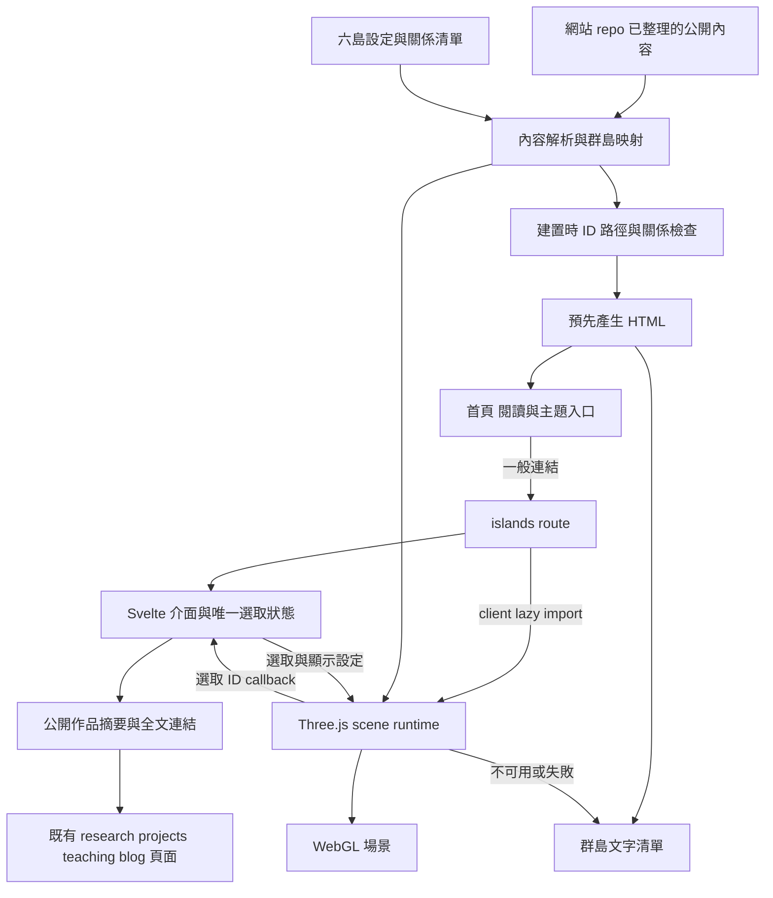
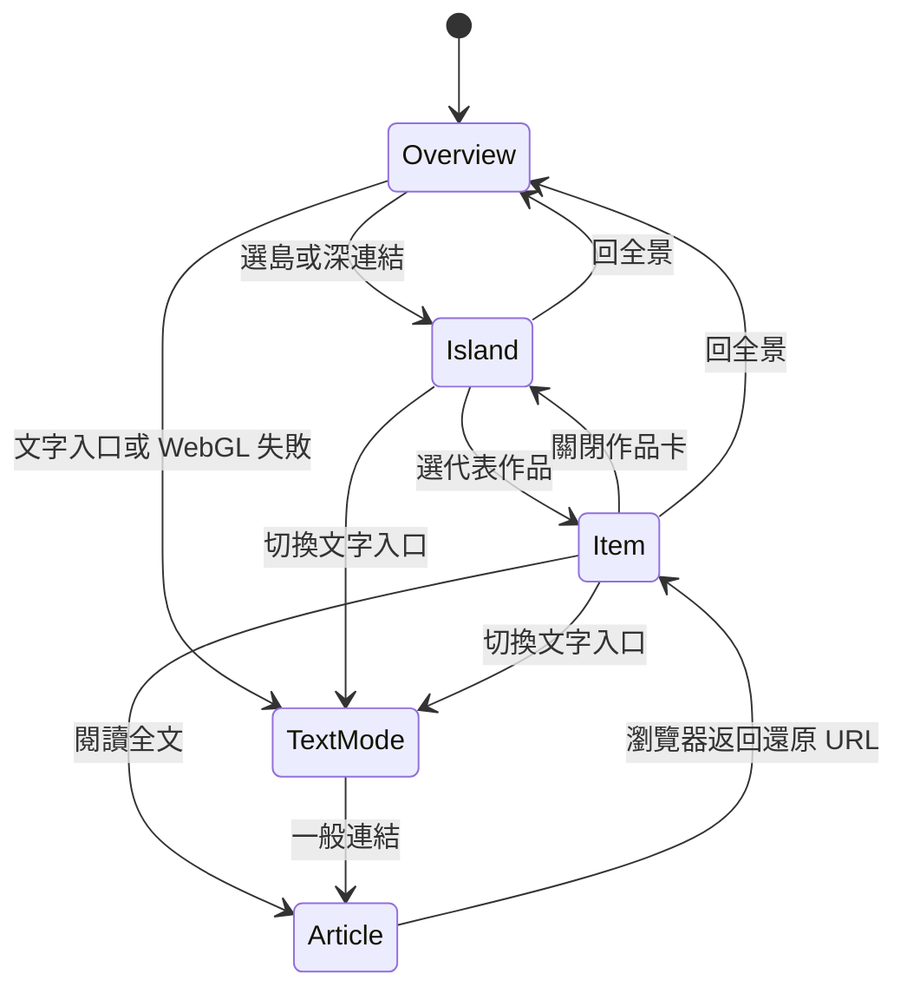
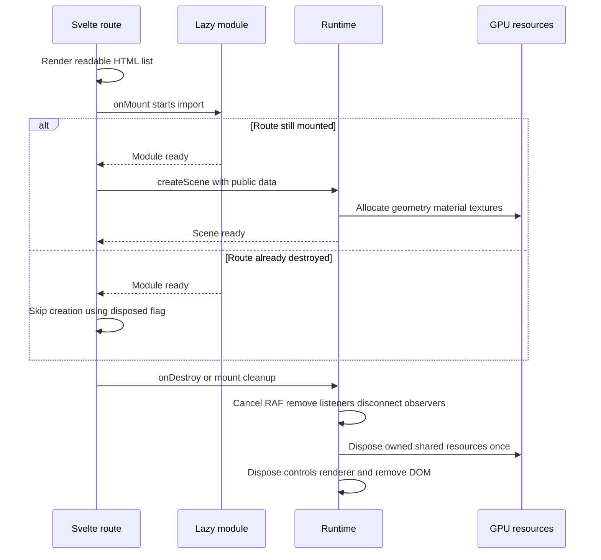

# 自有網站工程規格

返回[閱讀入口](README.md)。這份規格供後續網站任務接手；本次只交付文件，不更動網站程式或依賴。

## 架構與選擇

沿用既有 SvelteKit + Svelte 5 + TypeScript + adapter-static。Three.js 直接整合，不先引入 React、React Three Fiber、Threlte、遊戲引擎或 CMS。理由是目前只有一個受控 3D route，現有內容與頁面已能靜態產生。

原站使用 r160，未來實作需在當時選定並鎖住測過的 `three` 版本與同版 addons；不能直接把 r160 的程式片段套到未查核的新 API。套件新增只發生在網站實作階段。



首頁不 import 場景程式；只有 `/islands/` 掛載後啟動。預先產生的清單在 JS 載入前即存在，3D 失敗也不移除。官方 [adapter-static](https://svelte.dev/docs/kit/adapter-static) 支援靜態頁面輸出；沿用既有 prerender、trailing-slash 與部署設定。

## 內容介面與責任

以下是**擬定的最小介面**，不是目前已存在的型別。新增 metadata 放在網站 repo 的群島內容模組，文章正文仍由既有 `site.ts`、blog 與教學來源負責。

```typescript
type IslandId = 'ai' | 'security' | 'work' | 'skills' | 'learning' | 'writing';
type Vec3 = readonly [number, number, number];
type ContentId = string; // 穩定命名，如 project:project-aura

type Island = {
  id: IslandId;
  title: string;
  summary: string;
  position: Vec3;
  theme: IslandId;
  featured: readonly ContentId[]; // 至多三項；內容從公開來源解析
};

type ContentReference = {
  id: ContentId;
  sourceKind: 'research' | 'project' | 'writing' | 'teaching' | 'external' | 'skill';
  sourceKey: string;
  homeIsland: IslandId;
};

type Relation = {
  id: string;
  from: ContentId;
  to: ContentId;
  label: string;
  evidenceHref: string; // 公開可讀、足以支持關係說明的頁面
};

type Selection =
  | { kind: 'overview' }
  | { kind: 'island'; islandId: IslandId }
  | { kind: 'item'; contentId: ContentId };
```

`ContentReference` 是指向文章的參照，不再抄一份 title、summary、status。解析器把不同既有內容型別轉成 UI 所需的 display model；技能與外部課程缺少既有 record 時，新增最小公開 record，包含名稱、說明、目的 URL 或 supporting content IDs。技能沒有證據連結就不能列為代表能力。

資料流程：公開 record → stable content ID → homeIsland → 地標 → 選取回報 → 同 record 的內容卡。搜尋與文字清單用同一份解析結果。顯示 `status` 時保持原文意義，缺少狀態就不填，不能以資料存在推成完成。

建置檢查：ID 不重複；六島 ID 唯一；每個 featured 與 relation 端點能解析；同一 content 只有一個 homeIsland；內部 href 對應 route；外連只接受整理過的 http／https；定位座標為有限數值。不存在的文章或關係不能靜默降級成可點的空卡。

## 模組邊界

| 層 | 擁有內容 | 不承擔的責任 |
| --- | --- | --- |
| 內容映射 | 公開 record lookup、六島、關係、搜尋用文字 | 不建立 WebGL 物件 |
| route／Svelte UI | 搜尋、清單、Selection、panel、焦點、一般連結 | 不逐幀更新幾何 |
| scene runtime | renderer、相機、controls、資源、resize、tick | 不擷取私人資料或決定文章成果狀態 |
| island builder | 岩體、植物、地標、hit proxy、局部 batch | 不直接改 Svelte DOM |
| relation renderer | 曲線、端點與方向提示 | 不自行推論內容關係 |

runtime 最小公開介面為 `setSelection(selection)`、`setMotion(enabled)`、`resize()`、`dispose()`；建立時傳入容器、公開資料與 `onSelect(selection)`。不要先抽成可替換多引擎的 plugin 系統。Svelte 與 runtime 都可持有當前顯示參照，但只有 UI Selection 決定正在閱讀的內容。

## 互動與 URL

`/islands/` 是全景；`?island=ai` 是主題深連結；`?item=project%3Aproject-aura` 是作品深連結。有效 item 優先於 island，因為可以由 item 得知其島；無效 item 可退到有效 island，均無效則回全景並顯示溫和提示。值必須通過公開 ID map，不拼接任意 HTML 或外連。

選取更新 URL 使用網站路由機制，只有使用者明確選取才新增歷史項；相機逐幀移動不寫 history。瀏覽器返回／前進從 URL 還原 Selection。關閉作品卡回該島，回全景清除選取參數。搜尋暫留 route state，不存瀏覽紀錄或後端。

手機只有 `closed | list | detail` 一個 panel 狀態；開清單會關 detail，選內容會把 list 換成 detail。Escape 關閉當前面板並恢復發起元素焦點。全景和文字入口始終可達；Tab、Enter 可完成瀏覽而不操作 canvas。



## 懸浮、航線與相機

每島一個 Group，局部座標原點位於島頂中心。底部岩體在負 y、建物在正 y，整個 Group 放到指定世界座標。浮動只改 Group 的 y；hit proxy 與 label anchor 同為子物件。合批先限制在島內，避免父級變換與世界 batch 不一致。

航線端點讀取島上 anchor 的世界座標，每次島浮動更新時重算曲線控制點；低動態模式使用基準位置。兩端之間用三維 cubic Bézier，抬高中央控制點避免穿入島體；第一版只在選取時建立最多四條線。線不參與碰撞導航，點選關係由文字按鈕完成。

全景 fit：計算六島含岩體的 bounding sphere；距離至少為 `radius / sin(min(verticalFov, horizontalFov)/2)`，再乘 1.2 留白。水平 FOV 由 aspect 推得。桌面計算可用 canvas 區域扣除側欄，手機扣掉當前面板保留區；resize 後重算安全框。選取鏡頭以目標島局部 bounds fit，不沿用原站平面 TOP 假設。

鏡頭轉場預設 650ms ease-in-out；pointerdown 中斷，自然手動控制優先。減少動態時直接定位。相機保持島頂可見，orbit 限制俯仰 25°–70°，不提供第一人稱飛行。這些是設計預設，視覺驗收如需改動應保留原因。

## 生命週期與失敗處理



`onMount` callback 同步回傳清理函式，非直接把 async 函式交給它；非同步載入需 disposed flag，避免訪客離開後才建立場景。依 [Svelte lifecycle](https://svelte.dev/docs/svelte/lifecycle-hooks) 與 [Three.js Cleanup](https://threejs.org/manual/pages/cleanup.html)，geometry、material、texture 由擁有者釋放；共用物件用 Set 去重，材質引用的 texture 另外釋放。

只註冊一條 RAF。頁面不可見時停止排程，恢復時重設 timestamp；pause／reduced-motion 停止裝飾與漂浮，使用 dirty request 服務相機或選取變化。context lost 時顯示文字清單與重試；context restored 不假設舊 GPU 資源全部有效，採可銷毀再建立的路徑。

模組載入或場景初始化失敗只影響 3D 區，既有文字內容仍保留。重試清掉先前部分初始化資源，避免堆疊 canvas。網站其餘頁面不依賴 runtime。

## 初版效能預算與驗收目標

以下皆為**設計目標，未測量**：首頁 3D JS 請求數為 0；群島專屬程式與初始資產 gzip 傳輸目標合計不超過 2MB；桌面 DPR 上限 1.5、手機 1；每島最多三個主要內容地標；全景最多六個名牌。

實作時在具名桌面、Android Chrome 與 iPhone Safari 上，各測相同全景旋轉、選島、開卡的 30 秒路徑。桌面 p95 frame time 目標 ≤33.3ms，手機 ≤50ms；另記載入時間、draw calls、triangles、renderer memory 與控制反應。未取得設備即標未驗證，不用桌面縮窄視窗代替。

若超預算，依序減少透明雲與瀑布、陰影範圍、遠景小物與動態線，再調低 DPR；保留文字與點選功能。先量測瓶頸再引入進階 LOD 或大範圍合批。

## 接手時的階段與範圍

1. **內容與首頁切片：**核對三筆代表成果、完成首頁桌面／手機版、維持原文章 URL。
2. **三島切片：**AI、資安、工作三島，九個以下地標，完成點選、清單、深連結與失敗回退。其餘三島仍在完整規格中。
3. **六島展開：**技能、教學與寫作加入，增加有依據的少量關係航線。
4. **視覺與效能：**調整地形、植被、雲與低動態；完成真實裝置與生命周期測試。
5. **發布準備：**內容審閱、`npm run check`、`npm run build`、既有 route 回歸、預覽與部署收據。發布需另有明確任務授權。

API 變動限於網站內部內容 metadata 與 scene runtime；無新伺服器 API、帳號、資料庫、Notion token 或個人追蹤。公開頁面維持既有路由，新增 `/islands/`；舊首頁仍可透過 Git 歷史回復，詳細文章不因視覺改版搬家。
