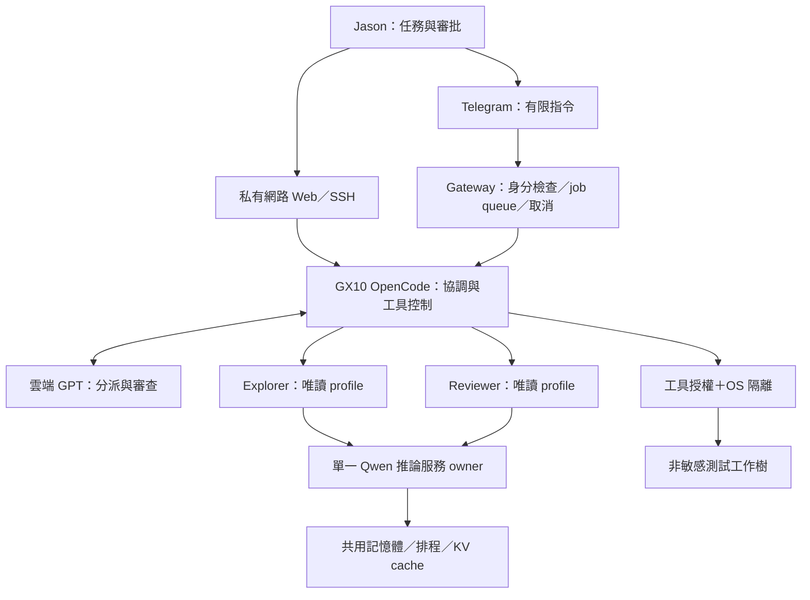

# GX10 × OpenCode：Qwen workers、遠端控制與近期 MVP 目標

2026-11-16（Asia/Taipei）。Canonical：[`idea_000049`](../structured/idea_000049_gpt_nemotron_hybrid_coding_agent_architecture.yaml)。[既有架構與歷史](README.md)／[本次完整供稿](source-2026-11-16-qwen-remote.md)／[來源完整性清冊](source-2026-11-16-manifest.json)。

## 使用者目標與本次採納

Jason 表示：「我最近的目標之一是很想做到這個。」具體想做的是在 GX10 上，以 OpenCode、GPT 主控與多個 Qwen 本地 subagents 建立 MVP，並可從 Telegram 或其他遠端介面操作。這是明確的近期目標；具體 checkpoint、推理強度、控制介面、工時與交付日期仍待決定。

本次延續 11/04 的同一個混合代理問題，沒有另開相同構想。Nemotron Super／Nano 留作歷史候選，最新 Qwen 方向在此承接；兩者尚未經同條件實測比較。供稿中的推薦與範例屬於提案，沒有整份自動採納為可執行設定。

| 證據層 | 本次狀態 | 可支持的結論 |
| --- | --- | --- |
| 來源 | source preserved | 七節全文、程式碼、指令、表格、連結與結尾理解題已保存 |
| 使用者決定 | adopted decision | 近期想完成 GX10 混合代理與遠端操作；可持續追蹤 |
| 設計解讀 | proposed | 三層架構、兩個唯讀 worker profiles、漸進併發與遠端順序 |
| 公開技術文件 | partially verified | 下列查核表所列官方能力與版本限制 |
| 實作／GX10 驗收 | implementation pending | 本輪未安裝、下載權重、啟動服務、呼叫付費模型或發送 Telegram |
| 發布 | not published in this task | 本地筆記與連結更新；本輪未 commit／push |

## 架構與專業建議

稀缺資源是 GX10 共用記憶體、本人可投入時間、可核對的交接證據與控制權。完整思考留 brainstorming-lab；Planning 只承接定位、容量與下一關。進入工程時，先確認獨立 execution owner，並與既有 ai-inference-platform 的服務 owner 協調；本次不另建一套模型平台。

這是提案圖。Telegram 訊息經 Telegram，送給 GPT 的上下文經雲端；本地 workers 不會使整個工作流成為純本地。遠端客戶端操控 GX10 的 OpenCode，工具實際執行位置仍在服務端。

建議把第一個成果限縮為「一個主控把一個有明確答案的唯讀子任務交給指定本地模型，回傳檔案／行號，主控核對後交付」。兩個角色可以先後執行，共用一個 endpoint。只有服務日誌證明請求重疊時才記為並行；兩個角色設定本身不證明同時推論。

遠端完整操作優先考慮私有網路上的 OpenCode Web 與 SSH；手機短任務再加 Telegram。若已有可用私有連線，先重用現況，避免同時引入新網路與新 gateway。NVIDIA Sync 也可列為筆電維運候選，官方指南描述 SSH tunnel，但 GX10 適配與本機整合仍待核。

## 2026-11-16 技術主張查核

查核只讀取公開文件；未確認帳戶可見模型、主機已裝版本或端到端行為。原文的 favicon、「+1／+2」不是完整文獻；下表用可回查的一級來源補足關鍵依賴。

| 主張 | 本次證據與判讀 | 下一個驗證 |
| --- | --- | --- |
| `gpt-6.1-max` | [OpenAI 模型頁](https://developers.openai.com/api/docs/models/gpt-6.1-sol)列 `gpt-6.1-sol`，`reasoning.effort` 支援 `max`；tool calling 使用 Responses API。模型 ID 與 effort 分開記。 | 查帳戶與 OpenCode provider 的實際可用模型、variant 與 API 路徑；不從本次 assistant runtime 推論帳戶能力。 |
| Qwen FP4-Local | [NVIDIA 模型卡](https://huggingface.co/nvidia/Qwen3.8-Flash-Next-FP4-Local)列約 96 GiB 磁碟工件、DGX Spark 支援與指定容器要求；壓縮格式尚未進入 upstream vLLM。範例含 `qwen3_xml`、host networking。 | 固定 revision／image digest、ARM64 相容性與工具解析；實機總記憶體另量測。 |
| 原始 NVFP4、27B 備援、17–49 tokens/s | 本輪沒有逐項核實原始 NVFP4 的需求、27B 配方或社群效能來源。保留為供稿候選與來源數字。 | 先查各模型卡／固定配方；不能用吞吐範圍保證本機表現。 |
| OpenCode V2 設定 | [Config](https://opencode.ai/docs/config/)與[Agents](https://opencode.ai/docs/agents/)支持 `providers`、`agents`、`default_agent`、variant 及 steps。主代理 ID 切換不一定切換 session 模型。 | 依實際版本做 schema 與 session 模型核對；供稿 JSON 保留為未測範例。 |
| 權限與繼承 | [Permissions](https://opencode.ai/docs/permissions/)描述有序規則與最後符合者優先。各角色需獨立檢查最終權限；目前證據不把父層限制當成子代理保證。 | 明確測外部目錄、秘密檔、shell、edit、subagent 拒絕；讀取與搜尋的路徑控制也需核對。 |
| vLLM tool calling | [Providers](https://opencode.ai/docs/providers/)指出 vLLM 自動發現無法推斷工具支援；明列能力不等於 parser 正常。 | 用合法 tool schema、正常參數及錯誤恢復驗證後再宣稱工具可用。 |
| Web／配對 | 現行[CLI Web](https://opencode.ai/docs/cli/web/)描述密碼保護、localhost、一次性配對及 SSH forwarding；[CLI](https://opencode.ai/docs/cli/)描述 shared service。`/docs/web/`、`/docs/server/`會導向 V1，須防版本混用。 | 實際版本、服務位址、登入與拒絕未授權連線分別驗收。 |
| Telegram long polling | [Bot API getUpdates](https://core.telegram.org/bots/api#getupdates)支持 long polling，與 webhook 互斥，需更新 offset。 | gateway 持久化 offset／去重、job 狀態與取消；斷線重啟不能重複派工。 |
| 第三方整合 | [HenryYannis](https://github.com/HenryYannis/opencode-telegram-remote)與[isMeStranger](https://github.com/isMeStranger/opencode-telegram-bot)頁面可讀。 | 未審查程式、依賴、token、授權或 V2 相容性；先固定 commit 再評估，未選為正式依賴。 |
| 網路候選 | [Tailscale SSH](https://tailscale.com/docs/features/tailscale-ssh)與[NVIDIA Sync 指南](https://build.nvidia.com/spark/vllm/intermediate)提供遠端連線路線。 | 選擇一般 SSH over tailnet 或 Tailscale SSH，核對 ACL 與設備；非本次設定操作。 |
| 安全風險 | [OWASP LLM01:2025](https://genai.owasp.org/llmrisk/llm01-prompt-injection/)支持間接提示注入風險分類；LLM06 頁本輪讀取逾時。 | LLM06 原文歸因保留待查；防護依工具、檔案與網路控制的實測證據判定。 |

## 設定與安全的待修訂處

原文 JSON 是來源證據，沒有寫進任何生效中的 `opencode.jsonc`。後續落地時，保留兩個 worker 的預設拒絕，再明確允許所需唯讀工具；orchestrator 的 shell／edit 為 ask 仍代表具備請求執行的能力，若第一關完全唯讀，應改為明確 deny。逐一檢查所有角色與全域／系統設定合併結果。

`read: "*"` 涵蓋哪些檔案、`grep` 的 resource 是查詢式而非搜尋目錄、專案內 symlink 是否可越界、外部目錄規則如何作用，都應透過拋棄式測試工作樹驗收。以假 `.env` 和合成機密測拒絕，不放入真實金鑰。檔案唯讀不會自動阻止資料送到 GPT；資料出境範圍需獨立定義。

Telegram gateway 的建議責任：`user_id`＋私人 `chat_id` allowlist、有限命令、job_id、執行預算／timeout、去重、取消與結果遮罩。取消須追蹤 gateway、OpenCode session 與推論請求的實際終態，區分「收到取消」和「停止執行」。高影響批准綁定工作、動作與期限；重播、過期或不同工作使用同一批准皆應拒絕。Telegram 只傳任務摘要、狀態與安全結果，秘密資訊與敏感原始內容留在既有受控表面。

既有 Hermes 的 `drive-alt-control` 是紀錄中的唯一 production gateway／scheduler owner。新構想先確認現況；同一 bot token 不另開第二個 polling owner，也不因這份筆記遷移、停用或接管 Hermes。OpenCode 與 vLLM 初期維持 localhost／可信私有路徑，公開入口與 Cloudflare DNS／Tunnel／Access 變更另行決策。

## 最小下一步與後續關卡

G0 是下一個決策，G1–G4 是後續提案，沒有排入固定時段。

| Gate | owner／可審閱輸出 | 通過條件與範圍 |
| --- | --- | --- |
| G0：啟動準備 | Jason 定容量／費用／資料範圍；維護者列既有服務 owner、候選版本與非敏感 repo | 決定 execution home 與第一個唯讀任務；共用資源不衝突；只需要可審閱的小契約。 |
| G1：單模型可用性 | execution owner 保存模型／容器 revision、真實請求與錯誤 | 載入、一般回應與工具參數可解析，未 OOM；只證明所測路徑可用。 |
| G2：交接與權限 | OpenCode owner 保存指定模型呼叫、檔案／行號、拒絕紀錄與審查 | GPT→Qwen→GPT 可追溯；唯讀工具及拒絕越權均符合宣告。 |
| G3：遠端控制 | gateway owner 先私有 Web／SSH，再 Telegram | 合法使用者提交／查詢／取消；未授權、重複訊息、重播批准與外部直連遭拒；重啟後狀態可恢復。 |
| G4：比較價值 | execution owner 另立同條件評估契約 | GPT-only／Qwen-only／Hybrid 使用相同任務、權限、驗收與重試預算；品質、延遲、成本與違規分開。 |

原文的約 20 項任務、併發 1→2→4、六個核心指標保留為後續方案。先以單次可核對交接辨識瓶頸，再決定是否值得擴大；本次沒有新建 benchmark 或宣稱實驗完成。未來量測應保留 cloud token、retry、queue wait、prefill／decode、工具時間與維護成本的定義；成本缺電力／折舊資料時只報實際可取得項目。20 項任務可作初步工程判斷，p95 的統計穩定性另行處理。

停止／縮小條件：無法識別實際模型、工具越權、秘密或資料範圍外傳、干擾既有服務、OOM／資源不足時先停該路徑。Hybrid 若在相同驗收與預算下沒有可接受收益，降低分派頻率、改小模型或回到單模型；收益門檻由 Jason 在比較前選定。

暫緩大量 swarm、寫入 executor、自建 dashboard、censored／uncensored 比較、正式敏感 repo、公開服務與自動部署。原文結尾理解題作為設計問題保存，未啟動教學或測驗。

## 有理由的關聯與回查

| 相鄰資料 | 連結理由／可重用內容 | 保留的 owner 與界線 |
| --- | --- | --- |
| [idea_000043](../structured/idea_000043_shared_gpu_model_owner_inference_service.yaml)／[服務說明](../2026-05-28-shared-gpu-model-owner-inference-service.md) | 一個 model owner、多個請求、queue／KV cache；直接支援共用本地 workers。 | 舊 RTX 5080 背景保留歷史，當前 GX10 與服務資源另核。 |
| [idea_000027](../structured/idea_000027_long_horizon_agent_behavior_evaluation_for_codex_cli_orchestrati.yaml) | 真實工具事件、狀態漂移、token 放大、交付證據；用於定義 Hybrid 是否值得。 | 歷史 agent 評估不能拿來證明本 MVP 的效能。 |
| [idea_000020](../structured/idea_000020_gpu_first_terminal_as_ai_engineering_workbench.yaml)／[終端工作臺](../2026-05-09-gpu-first-terminal-ai-workbench.md) | CLI／tmux 與延遲、可觀察性；支援遠端維運與恢復入口。 | 終端互動品質與推論吞吐分開評估。 |
| [idea_000019](../structured/idea_000019_codex_wrapped_ai_scientist_research_os.yaml) | 既有關聯：協調、結果追溯與人類關卡。 | 不擴張為 AI Scientist 專案或恢復其暫緩工作。 |
| [GX10 模型研究](../../../planning-everything-track/data/projects/2026-10-gx10-local-model-research.md#gx10-opencode-qwen-2026-11-16) | 硬體更換、NVFP4 候選與既有 btop 觀測入口。 | censored／uncensored 比較保留獨立目標，FP4-Local 不自動替換既有實驗。 |
| [AI Inference Platform](../../../planning-everything-track/data/projects/2026-10-ai-inference-platform.md#gx10-opencode-qwen-2026-11-16) | 可能重用 inference endpoint、模型 profile、資源與驗收紀律。 | 平台正式入口與既有私人實機 gate 維持原狀；接入由工程 owner 決定。 |
| [Hermes gateway](../../../planning-everything-track/data/projects/2026-07-hermes-cross-host-agent-distribution.md#gx10-opencode-qwen-2026-11-16) | 遠端 gateway 唯一 owner、憑證與排程的既有經驗。 | 不複製 token／對話或接管 production。 |
| [網域／GX10 平台](../../../planning-everything-track/data/projects/2026-10-cloudflare-domain-gx10-platform.md#gx10-opencode-qwen-2026-11-16) | 私有遠端與既有網域資產需分清，避免默認公開新服務。 | DNS／Tunnel／Access 不因記錄目標而變更。 |

[11/16 日誌](../../../planning-everything-track/weeks/2026-W47/days/2026-11-16.md#gx10-opencode-qwen-2026-11-16) ↔ [W47 週計畫](../../../planning-everything-track/weeks/2026-W47/weekly-plan.md#gx10-opencode-qwen-2026-11-16) ↔ [構想 locator](../../../planning-everything-track/data/projects/2026-04-brainstorming-lab.md#gx10-opencode-qwen-2026-11-16) ↔ [brainstorming bridge](../../../planning-everything-track/docs/15-brainstorming-repo-bridge.md#gx10-opencode-qwen-2026-11-16)。

W47 Red／待重評；11/17 TA、11/19 HAI／課務及恢復仍須保護，CEHP 改班釋出的時間沒有自動成為新工程容量。下一個可決策成果是 G0 的最小啟動契約；沒有新增截止、固定區塊或每日配額，也不把本次代理整理當作 Jason 的學習輸出或投入分鐘。

## 本次紀錄驗證

- `normalize_problem.py idea_000049` 與 `score_maturity.py idea_000049` 已執行；CLI 得 69/100、演算法分類 research_candidate。生命週期人工維持 structured，原因是本輪新增供稿與查核，尚無本 MVP 的實際摩擦／運行證據；這項分離已記入 YAML。
- `link_ideas.py` 新增 049↔020、049↔027；既有 049↔019、049↔043 保留。人工說明列出每條關聯理由，鄰接 YAML 的重排已縮到必要新增連結。
- Idea／tag／cluster／research-candidate 索引與 clusters 已由原 CLI 重建；沒有變動的產物維持原樣。
- `python3 -m unittest`：29 項通過；三筆 touched YAML schema 通過。62 個新增本地連結／錨點檢查通過；供稿 SHA-256、位元組數、七節與三個程式區塊核對，JSON 可解析僅證明語法。
- Planning `validate_repository.py` 通過，44 項既有 grandfathered warnings，新增 0；兩 repo `git diff --check` 通過。這些是紀錄與 repo 檢查，不是 GX10 模型、權限或遠端功能驗收。本輪沒有 Git 提交／推送。
