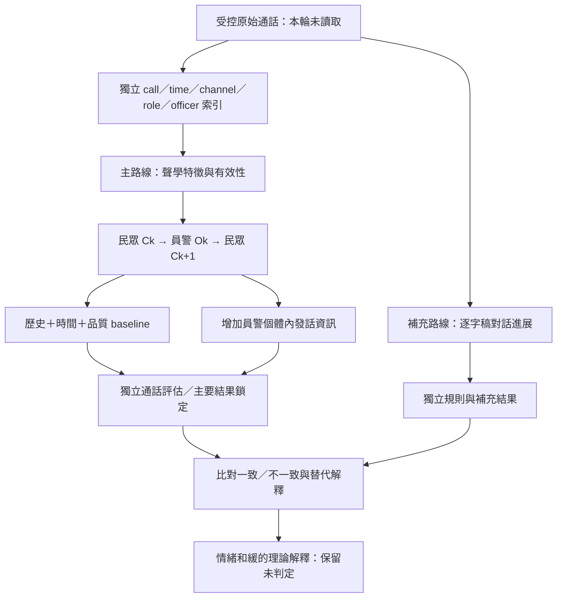

# 165 諮詢電話：聲學主線、雙人互動與跨回合預測

2026-11-16（Asia/Taipei）。[完整供稿](source.md)／[來源清冊](source-manifest.json)／[canonical idea_000036](../structured/idea_000036_165_antifraud_consultation_interaction_science.yaml)／[既有 165 思考歷史](../2026-05-22-165-antifraud-consultation-interaction-science.md)／[本次文獻查核](literature-ledger.md)。

## 本次明確採納的研究範圍

Jason 表示已拿到 165 反詐騙專線中員警與疑似受騙民眾的通話語音。本人希望研究員警聲音是否穩定、穩定與情緒起伏的關係、何種員警發話與民眾和緩有關、民眾接通時與後續的變化，以及與問題處理進展的關係；情緒無法判定也可接受。另希望比較聲音測謊的方法論。

`adopted decision`：主研究僅依聲學量測推論。聽者主觀情緒評分、當事人陳述、正確重述、執行步驟、適當轉介與後續紀錄不作主要判準。逐字稿保留為最後、獨立的補充佐證路線；不以文字先定義安撫成功，再回頭選聲學特徵或主模型樣本。

`scope change`：既有 `idea_000036` 的人工認知狀態 codebook、10-call outcome annotation pilot 與舊 paper framework 保留為歷史；本次聲學主線優先。舊來源的認知／介入／結果語言是研究假說，沒有因此成為已量得的心理狀態。舊資料量「30 小時」本輪未重核，後續方案不預設其正確或代表現存完整通話。

`confirmed` 的範圍是本人陳述與保存的來源；本輪沒有查驗音檔、資料筆數、角色／聲道、時間重建或跨通話員警代碼。文中 40–60 通是供稿的工程試驗例子；180 通／12 位員警是理解案例；均非本輪實際樣本量、檢定力結論或承諾配額。

## 主問題、假說與可支持的結論

保留全部原始情緒與問題解決問題，將主要可驗證層定為：在知道民眾前一段聲學狀態、通話進程與可取得的品質條件後，加入員警當次發話的聲學資訊，是否增加對民眾後續聲學變化的可重現解釋／預測能力？此問法是設計提案，尚無 165 實證結果。

| 原始關心 | 聲學操作化候選 | 結果解讀與下一層證據 |
| --- | --- | --- |
| 員警較穩定？ | 相同通話內角色的 F0／節奏變異、跨回合差異 | 角色聲學差異；保留設備、內容與任務替代解釋。 |
| 穩定代表情緒起伏小？ | 位準與變異分開，多個聲學面向是否一致／相反 | 與情緒理論相容／不相容的證據；不能以自訂穩定分數驗證同名情緒真值。 |
| 民眾開頭是否激動？ | 預定早期區間對自身後續的聲學參照 | 通話內差異；缺少平日基準時保留「是否異於平常」未確認。 |
| 哪種員警聲音有幫助？ | 個體內發話調整與下一段民眾聲學狀態 | 增額預測與前導關聯；安撫因果尚未識別。 |
| 民眾是否持續和緩？ | 多回合位準／變異／節奏軌跡、持續與反彈 | 聲學和緩候選軌跡；沉默、耗竭、換內容或通道改變仍可能解釋。 |
| 是否引導問題解決？ | 主要結果鎖定後，比對獨立文字的對話進展 | 補充跨模態一致或不一致；通話外實際問題解決未獨立確認。 |
| 與測謊何處相似？ | 比較週期、韻律、狀態代理與構念效度問題 | 方法論文獻問題，沒有建立欺瞞／可信度或員警績效分類。 |

四種穩定分開：發聲週期、語句內韻律、跨發話單位、雙人互動。位準下降、變異下降、兩人接近與兩人同步也分開；兩人一起升高仍可能同步。`proximity`、`convergence`、`synchrony` 採各自定義。Jitter 與整句音高起伏不同，speaker embedding 與「情緒聲紋」也不同。

## 兩條資料路線與分析鎖定

主分析依可用聲學區間與停頓規則分單位，不需逐字稿定義完整語句。角色、時間與員警代碼是索引，可由獨立 metadata 或經核對的分段建立；不是主觀情緒評分。角色判定不能用待研究的「聲音比較穩」。若以人工確認角色／邊界，需記其任務為索引核對，與情緒標註分開。

補充文字可觀察問題焦點收斂、同疑問反覆、未解障礙與警民問題／回應對應；保留不同模態不一致的案例。補充結果不回流主特徵選擇、樣本選擇、閾值或情緒標籤。若未來確實改用文字控制、分群或訓練，需標為範圍改變，不能再稱目前的聲學主線。從逐字稿得到「對話有進展」也不自動確認實際行動或通話外結局。

## 特徵與統計方案：提案層

主特徵候選為 F0 中位數、半音 IQR、跨單位變化、聲學音節核速率代理、發話單位長度與停頓分布。RMS dBFS／包絡、HNR／CPP、合格區間的 jitter／shimmer、互動時距與 embedding 可作分開報告的擴充。沒有把上述方向預設為越低越好，沒有固定「安定分數」。各欄有效性／工具條件沿用 [idea_000063](../2026-11-16-phone8k-feature-validity/README.md)。

F0 的半音參照必須有明確來源。移除個人位準與強制等變異標準化是不同操作；後者可能抹掉穩定性差異。回溯描述可使用宣告過的全通話參照；早期預測只用當時已知資料。員警平均、normalization、feature selection 與任何 encoder 微調也遵守訓練／開發／測試隔離；新員警沒有歷史平均時，另定可用參照或明列該模型不適用，不能用未來通話偷建基準。

起始比較：

- B0：民眾前段／既有歷史＋通話時間＋可量得品質條件。
- B1：B0 加員警前一段特徵，拆為員警長期平均與個體內偏離。
- B2：另行探索民眾先前狀態與員警發話的交互作用、反方向民眾→員警，以及多回合持續性。

供稿方程原樣保存於[來源第四節](source.md)。其中 `X_{c,k}` 的下標需在實作前統一：建議令 `j` 表通話、`o(j)` 表員警、`X_{o(j),j,k}` 明確表示該回合員警特徵，`Y_{j,k+1}` 表民眾後續特徵；原式的 `c` 不可同時表示民眾與通話。這是符號澄清提案，沒有改動原始方程。

Mixed effects 可表達重複員警／通話結構，不能自動解決時間自相關、內生反應、缺失或因果混雜。實作前確認 call 是否巢狀於 officer、是否多位員警轉接、民眾是否重複、random slope 及參數可識別性。無逐字稿主分析時，字詞、語音內容與詞彙聲調仍可能是未控制混雜，不能宣稱已完整控制內容。只輸入音訊的 WavLM 仍可能編碼語言內容；手工韻律與深度表徵分開消融。

預測主終點應先擇一，定義時間跨度、單位、loss／效應與最小關注差異；目前尚未選定。正式樣本數需依通話／員警分群、變異與目標估計精度設計。來源 40–60 通不替代檢定力分析，也未排程。

## 競爭假說、反證與缺失

| 假說／替代解釋 | 提案中的檢查 | 什麼情況需要修訂 |
| --- | --- | --- |
| 固定穩定 vs 適應性調整 | 比較一致發話與依先前民眾狀態改變的模型 | 不預先選「低／慢／平」為最好；沒有重現增益則保留未支持。 |
| 民眾自行延續／自然時間趨勢 | B0 對 B1；不只報主模型顯著係數 | 新通話上沒有增額預測時，不說員警特徵有效。 |
| 回歸平均／結尾變短 | 事前抽樣、等量有效語音、去除結尾敏感度 | 效果只由高點或結尾驅動時修訂和緩解釋。 |
| 共同事件／反向調整 | 雙向 lag 與可用控制 | 時間先後不等於因果，員警可能在回應民眾已發生的變化。 |
| 偶然協調 | 保留單人時間結構與通話階段的 surrogate pairing | 隨機洗牌破壞自相關的 null 不作唯一證據。 |
| 通道／AGC／設備識別 | 原音為主、已知通道擾動與品質分層；新設備／新員警測試 | 擾動改變量與目標差異相當、增益只在熟悉座席存在時縮小結論。 |
| 只保留容易量測片段 | valid coverage、失敗原因、角色／階段／品質分層排除率 | 無 F0 不填 0；不能刪除高噪／哭聲／重疊後代表整通電話。 |
| 片段／身份洩漏與多重比較 | 同 call 留同組；新 officer／channel 測試另報；主要少數終點 | 未見資料不能重現、探索結果未校正時，保留探索性質。 |

來源提出六個延伸：適應性調整、方向不對稱、持續／反彈、初始狀態適配、跨通話聲學延續、量測失敗模式。前三個是來源建議優先組合，具體主假說仍由 Jason 決定。跨通話方向另依排序、間隔與授權 metadata，不能直接稱疲勞／耗竭。這些延伸沒有同時啟動。

## 文獻與測謊比較的用途

[文獻查核表](literature-ledger.md)把供稿的每條外部證據與可支持範圍分開，並補上原文缺少的自然電話雙語料研究來源。理論導向 unsupervised arousal 可作相關方法；它仍有特徵方向、參照與外部效度的假設，不等於無情緒真值也已獨立驗證情緒。已有標註專線研究可支持研究可行性背景，其標註來源不轉成我們的主判準。

聲音測謊僅為方法論比較：聲學變化→壓力→欺瞞→陳述真假的每層證據分開。VSA microtremor、Praat jitter 與 speaker embedding 的定義不同；文獻中特定系統／特定情境的低敏感度與誤報不能推廣成所有未來模型永遠無效，也不能變成可用測謊的證據。本輪沒有建立個人欺瞞、可信度或員警排名。

## 下一個可審閱成果與確認表

先確認資料索引能否支持連續三段，不因收件而讀取受限錄音。未來的最小資料單位：`call_id / channel / start_sample / end_sample / role / officer_key / segment_id / previous-next / valid_duration / quality / missing_reason`；metadata 與匿名 key 對照保管分開。

| 缺口／下一關 | owner | 觸發與回填 | 可支持的下一層 |
| --- | --- | --- | --- |
| 原通話／時間／角色能否重建、跨通話員警代碼是否可靠 | 資料 owner | Jason 明確啟動資料盤點時，回填本節；本輪未盤音檔 | 孤立片段只支持分布；有相鄰發話才支持局部；完整時間才支持軌跡；重複員警碼才支持個體內／間分解。 |
| 一項主要假說與聲學終點、最強反證 | Jason／研究 owner | 有容量且完成索引可行性判斷後 | 形成可審閱分析契約；情緒問題仍保留可未判定。 |
| 受控 execution home、資料授權、固定 runtime | Jason／維護者 | 實際處理前 | 音檔、embedding、逐字稿與日誌留受控 owner；本次不建替代 repo。 |
| 補充文字規則與主結果鎖定機制 | 研究 owner | 分析契約審閱時 | 兩路獨立，避免主線被文字標籤滲入。 |
| 文獻細節與模型估計識別性 | 後續分析者 | 方法選定後 | 核對未完整讀取的效應方向、估計假設與樣本數需求。 |

停止／暫緩：無法重建時序時不做全通話軌跡；無法獨立定角色時不驗證角色穩定差異；缺跨通話身份時不聲稱 officer 長期效應；沒有相應主假說、授權與 runtime 時不做新資料處理、40–60 通試驗、ASR／降噪比較、手稿／投稿恢復或自動化分類。保留資料選擇偏差：165 求助者不代表所有疑似受騙者或詐騙者。

## 關聯與所有權

| 相鄰入口 | 直接連結理由／本輪更新 | 保留範圍 |
| --- | --- | --- |
| [idea_000036 舊筆記](../2026-05-22-165-antifraud-consultation-interaction-science.md) | 同一研究對象，新增明確 scope change 與歷史方案定位 | 原始思考留歷史，本次聲學範圍優先。 |
| [idea_000063](../raw/idea_000063_phone8k_multilayer_feature_measurement_validity.yaml)／[電話特徵方法](../2026-11-16-phone8k-feature-validity/README.md) | 從「有哪些特徵」前進到這個用途的主／補充分工；回填用途已選為 165 聲學互動 | Toolkit 仍未取得；方法字典與實測分開。 |
| [idea_000038](../structured/idea_000038_hidden_state_thinking_as_a_unifying_research_methodology.yaml)／[隱狀態方法](../2026-05-23-hidden-state-thinking-research-methodology.md) | 觀測與隱狀態分層、避免循環定義 | 保留情緒未能獨立判定的結果，不強制認知標籤。 |
| [idea_000039](../structured/idea_000039_nemo_curator_and_data_centric_ai_governance_infrastructure.yaml)／[資料治理](../2026-05-24-nemo-curator-data-centric-ai-governance-infrastructure.md) | call／time／role reconstruction、missingness 與 uncertainty propagation | 整理資料不等於啟動 ASR、重新訓練或情緒分類。 |
| [idea_000015](../structured/idea_000015_layered_voice_enhancement_in_consumer_voip_calls.yaml) | AGC／codec／降噪對聲學位準與擾動的混雜 | 原音主分析，修復版本只作另行設計的敏感度分支。 |
| [Janus locator](../../../planning-everything-track/data/projects/2026-05-cib-janus-asr-finetuning.md#165-acoustic-primary-2026-11-16)／[本機整合](../../../planning-everything-track/docs/14-local-integrations.md#165-acoustic-primary-2026-11-16) | ASR 若供補充逐字稿，沿用 baseline 與 custody 入口 | 主要聲學研究不依賴轉錄先成功；ASR availability 與 accuracy／timing 仍分開。 |

[Planning locator](../../../planning-everything-track/data/projects/2026-04-brainstorming-lab.md#165-acoustic-primary-2026-11-16) ↔ [bridge](../../../planning-everything-track/docs/15-brainstorming-repo-bridge.md#165-acoustic-primary-2026-11-16) ↔ [11/16 日誌](../../../planning-everything-track/weeks/2026-W47/days/2026-11-16.md#165-acoustic-primary-2026-11-16) ↔ [W47](../../../planning-everything-track/weeks/2026-W47/weekly-plan.md#165-acoustic-primary-2026-11-16)。

FIRST PRINCIPLE：稀缺資源為可識別的量測、受限資料保管、人工索引核對與研究注意力。brainstorming 持有來源／設計；未來 execution owner 持音檔與實驗；Planning 持狀態／容量／下一關。W47 Red／待重評，日況 Unknown；本輪沒有新排工時、截止或學習配額，固定課務、TA、HAI、個人 learning must-win 與恢復維持。Jason 的貢獻是確認資料來源並明確設定研究範圍，供未來研究設計與週回顧重用；代理整理不記為本人學習完成或實驗投入分鐘。

## 本次紀錄驗證與狀態

- source preserved：前三點本人範圍、十節建議、三個方程、五個文字圖與八題整合案例已保存；SHA-256／位元組與結構檢查通過。清冊保護已存文字，不代替獨立訊息匯出的逐位元比對。
- `normalize_problem.py`／`score_maturity.py` 已對 036 與 063 執行：036 由歷史 97/100 重算為 87/100，classification execution_ready；063 仍 58/100、algorithm structured，人工 lifecycle raw。分數為文字啟發式，不是新的實機／心理效度量測。036 runtime 與實驗仍 deferred_activation。
- Canonical 036 更新現行範圍、next steps／baseline／metrics／pressure test，舊內容完整留 historical 欄位；既有 Markdown 加現行入口。063 的選用途缺口由本次更新承接。036↔015／038／039／063 已是雙向關聯，驗證後沿用；沒有新增重複 idea 或無理由的 graph edge。
- 原 CLI 重建索引／clusters；29 項 `python3 -m unittest` 通過，3 筆 touched YAML schema、68 個本次本地連結／錨點與 4 組既有雙向關聯檢查通過。
- Planning `validate_repository.py` 通過：44 項既有 grandfathered warnings，新增 0；兩 repo `git diff --check` 通過。先前未提交的 OpenCode 與電話特徵工作保留，沒有 Git commit／push。
- 本輪完成範圍是紀錄、研究範圍更新、來源查核與關聯；沒有讀取實際通話、生成聲紋向量、執行 ASR／統計模型或進行 live experiment。樣本、標註、runtime、人體情緒判斷與論文有效性均未因 repo 檢查而驗收。

## 後續明確啟動｜316 原始來源分段已實際完成

Jason 後續附檔明確授權工程與執行，[165-diarization 回執](../../../165-diarization/docs/engineering-report.md)／[Planning locator](../../../planning-everything-track/data/projects/2026-11-165-diarization.md)已承接原始 316／316 的 A0 Nemotron 真實分段、完整來源 SHA 與輸出驗證、36 項 CPU tests。先前本筆記「未讀取／未實作分段」是來源收件時的歷史狀態；本段只更新後續分段工程，主要聲學假說、情緒、因果、實際問題解決與 Toolkit 的既有證據界線維持。

目前模型與角色品質仍待 genuine human references，DER／JER not_evaluated；沒有以人工活動／角色標註取代本研究排除的主觀情緒真值，也沒有重跑 ASR 或改原逐字稿。實作與敏感輸出留 execution owner，下一關是有授權與容量時完成活動／重疊 reference 與角色核對；未新增人工期限或時段。

## 後續工程｜原文對帳與說話者候選

[165-diarization 全批回執](../../../165-diarization/docs/reconciliation-report.md)已承接316份原文對帳及候選歸屬、47項 CPU tests與獨立全量驗證；原始 TXT／SRT 完整保留，既有對齊／ASR／分段重用，沒有新推論。未確定文字與重疊保留人工佇列；角色 unknown，語意與歸屬品質 not_evaluated。[Planning 狀態](../../../planning-everything-track/data/projects/2026-11-165-diarization.md#transcript-reconciliation-2026-11-16)持容量與下一關；本研究聲學主線及獨立文字補充的範圍維持。

### Astra medium 工程複核 v2

[指定模型複核](../../../165-diarization/docs/astra-uncertainty-review.md)已完成7類工程修正及316份重算／全量驗證，65項測試通過。v2保守規則下14,034 units有機器歸屬、194,646保留未定；前述v1候選與來源完整保留。候選數量非準確率；原音／角色／語意效度仍待獨立核驗，文字不回流為主要聲學模型的情緒真值。[Planning目前狀態](../../../planning-everything-track/data/projects/2026-11-165-diarization.md#astra-review-2026-11-16)保護容量與下一關。

### 11/16｜Audio-first完整替換Prompt

研究主線：以新版工程Prompt承接聲學主線；前述未啟動敘述保留為收件當時歷史。 [完整來源、範圍與下一關](../../../165-diarization/docs/audio-first-research-decision-2026-11-16.md)。

### 11/16｜全部Embedding與方向2、3、4、5

Jason選方向2跨回合、3同步與和緩區分、4狀態發現、5電話穩健性；完整來源與工程交接由165-diarization持有。 [決策、完整來源、候選清單與下一關](../../../165-diarization/docs/multi-objective-embeddings-decision-2026-11-16.md)。

## 2026-11-16 Git交接範圍

[日誌closeout](../../../planning-everything-track/weeks/2026-W47/days/2026-11-16.md#165-publication-closeout-2026-11-16)與[W47](../../../planning-everything-track/weeks/2026-W47/weekly-plan.md#165-publication-closeout-2026-11-16)記錄本次分開提交及保留雙方歷史的授權。本文與Idea OS保存可發布的研究選擇；指向165-diarization的連結為本機兄弟目錄定位。該execution home尚無Git或remote，完整工程供稿、本人原話與執行證據未因此發布至GitHub。
