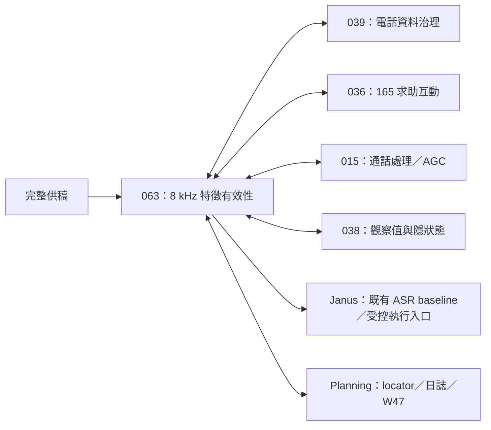

# 8 kHz 電話錄音：多層特徵、工具與量測有效性

2026-11-16（Asia/Taipei）。[完整供稿](source.md)／[來源清冊](source-manifest.json)／[canonical YAML](../raw/idea_000063_phone8k_multilayer_feature_measurement_validity.yaml)。本筆方法問題獨立於既有 165 應用與 Curator 治理構想，透過下方關聯圖互相連接。

## 本次貢獻與採納邊界

Jason 提供一份涵蓋十節的特徵工程問答，要求完整保存並連接相關筆記、日誌與週計畫。來源包括八類特徵地圖、物理限制、各項特徵表、四類 embedding、開源／免費工具、Toolkit 使用示例、四層系統、A–D 比較、165 的 P0–P3 優先順序與三題理解檢查。

本次成果是可回查的方法來源、有效性判讀與關聯。`confirmed` 僅用於已保存供稿及下方官方頁面支持的能力；具體 pipeline 與比較均為 `working assumption`／提案。`pending confirmation` 包含用途、資料授權、執行 owner、Toolkit 附件與真實電話測試。`deferred activation`：尚未處理音檔、下載模型、安裝套件、建立 engine 或執行實驗。

FIRST PRINCIPLE：稀缺資源是量測有效性、聲音資料保管、人工標註與注意力。brainstorming-lab 保存這份不含原始通話的技術供稿與方法；受限音檔、逐字稿、embedding 與執行證據留在未來確認的受控 execution home。Planning 只記定位、狀態、容量及下一關。

## 特徵地圖與依賴

原始各項名詞、定義、公式與單位完整保留於[來源第三至第五節](source.md)。本表補充如何判斷可用性，沒有宣稱所有項目已實作或可有效量測。

| 特徵家族 | 來源中的候選 | 取得方式／依賴 | 必須附帶的解讀界線 |
| --- | --- | --- | --- |
| 格式與波形 | duration、samples、sample rate、channels、subtype、peak、RMS／dBFS、DC、crest、dynamic range、clipping、ZCR | 解碼後按聲道分析；NumPy／SciPy／soundfile／FFmpeg 候選 | 記錄幅度縮放、滿刻度定義與門檻；dBFS 是錄音訊號位準。 |
| 時頻與能量 | STFT／FFT、centroid、bandwidth、rolloff、flatness、flux、entropy、contrast、slope、skewness、kurtosis、band ratio、modulation、noise floor | 窗長／hop／頻帶／功率或幅度譜需固定 | 空頻帶、靜音或分母為零標記缺失；不可把 noise estimate 當已知真實 SNR。 |
| 基頻與韻律 | F0 contour／quantiles／range／IQR／slope／delta、voicing、pitch reset、energy–pitch correlation | Praat、pYIN、openSMILE；保留有效有聲框與估計信心 | 電話頻帶可能移除基音；估計器可利用諧波週期，但倍頻、重疊、語言聲調仍影響結果。 |
| 週期與聲質 | Jitter local／absolute／RAP／PPQ5／DDP，Shimmer local／dB／APQ3／5／11／DDA，HNR／NHR／CPP／tilt／voice breaks | 明確母音區間、足夠有效週期、固定 pitch／period／amplitude 參數 | 自然對話與 codec／AGC 會混淆擾動；可計算不等於可靠生理指標，沒有通用電話診斷閾值。 |
| 頻帶相關聲質 | H1–H2、H1–A1／2／3、Hammarberg、alpha ratio | 逐項核對所需諧波／頻帶 | 需要的低頻或高頻成分可能不存在；插值／重取樣不補回證據。 |
| 倒頻譜與聲道 | MFCC／Δ／ΔΔ、Mel、LFCC、GFCC、PLP／RASTA、LPC／LPCC／LSF | librosa／其他 DSP 實作；各家族需個別確認工具 | 係數索引是否含 C0、濾波器與正規化須固定；不能把每一框當獨立樣本。 |
| 共振峰 | F1／2／3、bandwidth、movement、dispersion、vowel space | 穩定母音、適當模型階數、人工核對 | F3／F4 與高頻特徵受頻帶限制；vowel space 需要可比較的母音標註。 |
| 說話者表徵 | ECAPA、x-vector、TitaNet、cosine | 固定 encoder／revision／單人區間／取樣前處理 | cosine 不是同人機率；交叉設備、日期與說話內容需校準。向量具有可連結個人的能力。 |
| 通用／語義／環境表徵 | WavLM／HuBERT／wav2vec 2.0、SONAR 類、CLAP／BEATs／PANNs | 逐模型確定取樣率、層、pooling、維度與訓練領域 | 四類 embedding 不互換；座標沒有預設心理語義，模型接受音訊不證明電話場景效度。 |
| 語音活動與語速 | VAD、speech／silence、pause、utterance、burst、speech／articulation rate、filler、repair、syllable duration | VAD、轉錄／對齊與部分人工標註 | speech 與 voiced 不同；無語音可含音樂／噪聲。字／詞／音節與停頓分母需明定。 |
| 互動與內容 | diarization、turn、overlap、gap、response、backchannel、entrainment、dialog act、lexical／semantic／entities | 分離聲道或 diarization；ASR＋alignment／人工語用標註 | overlap 不自動等於打斷；speaker dominance 指標不等於心理支配感；ASR 錯誤會傳遞。 |
| 通道、事件與高階預測 | effective bandwidth、codec artifacts、DTMF／tones、MOS estimate、SER、laugh／cry／breath、spoof score | DSP／事件分類器／品質與情緒模型 | 通道來源未知時只報相符特徵；模型分數與真實 MOS、壓力、說謊或詐騙意圖分開。 |

8 kHz 每秒 8,000 samples 的 Nyquist 邊界是 4 kHz；來源所述 300–3,400 Hz 是典型電話頻帶描述，檔案的有效頻帶仍待檢查。升採樣供模型輸入使用；原始 8 kHz、原聲道、解碼與衍生路徑都保留。語音增強／AGC／正規化會改變部分特徵，因此不同處理版本不能直接混算。

量測層也包含演算法估計：F0、VAD、SNR 與分段不因歸在訊號層就成為真值；需要保留方法與信心。原文 `jitter_local = 0.02` 必須查 API 的比例／百分比單位；來源的 5.0–5.8 秒只是操作示例，不保證該 0.8 秒片段符合母音與週期條件。HNR／NHR 的線性或 dB 定義也需分開記。

這份地圖完整保存了供稿列出的特徵，實際可擴充集合依任務與模型而變；沒有一套免費套件能保證從任意一段 8 kHz 錄音有效取得所有特徵。

## 官方來源查核與工具選型

查核日期 2026-11-16。以下只確認頁面／模型設定，不代表本機已安裝、可離線使用或已通過量測；未讀取的工具保留為供稿候選。授權資訊是官方頁面當下標示，使用時須核對具體版本及用途。

| 工具／主張 | 官方來源與本次確認 | 待確認部分 |
| --- | --- | --- |
| Praat Jitter／Shimmer | [Jitter](https://praat.org/manual/Voice_2__Jitter.html)、[Shimmer](https://praat.org/manual/Voice_3__Shimmer.html)列五種／六種量度，通常對長持續母音量測。 | 電話語段的週期偵測與可接受誤差未驗；不採用文件中臨床閾值作電話判讀。 |
| openSMILE | [Python 官方文件](https://audeering.github.io/opensmile-python/)列 eGeMAPSv02 25 LLD／88 functionals，ComParE 65 LLD／65 deltas／6,373 functionals；免費版限私人、研究及教育等授權範圍，商業產品需另核。 | 8 kHz 空頻帶／濾波器設定與各欄有效性、本機 runtime 未驗。 |
| ECAPA | [模型卡](https://huggingface.co/speechbrain/spkrec-ecapa-voxceleb)列 16 kHz 單聲道；[設定檔](https://huggingface.co/speechbrain/spkrec-ecapa-voxceleb/raw/main/hyperparams.yaml)為 192 維。tensor API 需自行符合取樣率，不能假定自動轉換。 | 電話域 threshold、短片段與重疊效度未驗。 |
| WavLM Base Plus | [模型卡](https://huggingface.co/microsoft/wavlm-base-plus)明訂 16 kHz。 | 層／pooling／實際輸出 shape 與電話效度待固定；不把示例 768 維套用所有 WavLM。 |
| Silero VAD | [官方 repo](https://github.com/snakers4/silero-vad)列 8 kHz／16 kHz 與 MIT。 | VAD threshold、最短 speech／silence、邊界誤差未驗。 |
| pyannote Community-1 | [模型卡](https://huggingface.co/pyannote/speaker-diarization-community-1)列 mono 16 kHz，其他取樣率自動轉換，多聲道自動平均；取得需接受條件，可安排下載後離線。 | 雙端分聲道先保存／分開處理，避免自動 downmix 丟掉身份線索；本機模型與 token 未取得。 |
| CLAP | [官方 repo](https://github.com/LAION-AI/CLAP)提供 audio／text embedding；示例 data API 使用 48 kHz。 | 個別 checkpoint／API／授權及 8 kHz 領域落差待驗；不視為 speaker encoder。 |
| NISQA | [官方 repo](https://github.com/gabrielmittag/NISQA)區分 MIT code 與 `nisqa.tar` 等 CC BY-NC-SA 4.0 權重。 | 不同模型的前處理、來源語言與電話域校準未驗；分數不是受試者 MOS。 |
| PESQ | [Python wrapper](https://github.com/ludlows/PESQ)需要 ref／deg，8 kHz 為 nb。 | wrapper 授權不替代底層程式／標準用途審查；無參考原音時不可製造有效分數。 |
| librosa／SciPy／NumPy／Parselmouth | 保留來源工具路線；本輪 librosa `latest`／`main` 的指定 API 頁回 404。 | 實作前固定可回查版本與 API，核對 sample-rate／channel 預設；尚未逐一查核。 |
| DNSMOS、NeMo、faster-whisper、FFmpeg、torchcrepe、其他 HuBERT／SONAR／BEATs／PANNs | 來源候選；DNSMOS 指定 GitHub 子頁本輪無法讀取。 | 模型／套件版本、取樣率、功能、權重授權與本機相容性保留待查，不以列名代替可用性。 |

## Toolkit 與數字的證據界線

`Phone8K Feature Toolkit`、`phone8k_features.py`、ZIP、繁中 README、合成 Smoke Test、94 個逐框欄位／940 統計欄位均出現在供稿。本輪沒有收到下載網址、檔案本體、hash、程式或執行報告；已檢索的 repo 中也沒有該工具。因此狀態為 `source_claim_only`／`not_received`，沒有替來源聲稱已建立或測過工具。

供稿列出的輸出契約為 `summary.json`、`frame_features_10ms.csv`、`window_statistics.csv`、`f0_timeseries.csv`、可選 `vad_intervals.csv`、`egemaps_v02_88.csv`、`compare_2016_6373.csv`、`ecapa_192_embedding.npy`、`wavlm_mean_embedding.npy`。這些是來源預期檔名，本輪沒有產生實際音訊分析輸出。

94×10＝940；940＋88＋6,373＋192＋768＝8,361，算術成立，欄位存在與效度另驗。13 MFCC＋13 Δ＋13 ΔΔ＝39；10 ms hop 約 100 frames/s，因此約 3,900 values/s，邊界框數依 padding／窗長而異。每秒的值數、向量維數、獨立特徵與獨立受試者數需各自記錄。

來源中的 `python3 -m venv`／`pip install` 指令原樣保存供回查，沒有執行。未來若建立 uv-managed execution 專案，依現行政策以一個 `.venv`、`pyproject.toml`、`uv.lock` 與固定 Python 管理；既有環境先檢查，不因本輪筆記進行依賴遷移。

## 最小欄位契約與下一關

這是待審閱的方法提案，並未新增實作任務。先選一個用途與一小組可核對的特徵，保留可擴充的家族地圖。

| 契約部分 | 最小需要保存的內容 |
| --- | --- |
| 身份／來源 | recording_id、來源 hash、授權／保管層級、channel、segment_id、匿名 speaker key 與衍生檔 parent；身份對照留受控 owner。 |
| 時間 | 原始取樣率、start／end sample、秒數換算、窗長／hop、padding、時間基準；模型 stride 不強制視為 10 ms。 |
| 定義 | feature_id、家族、measured／learned／inferred 層、單位、shape、計算式、分母、頻帶、版本／參數。 |
| 有效性 | valid／not_applicable／failed、missing_reason、有效框／週期數、覆蓋率、噪聲／重疊／削波標記；缺失不用 0 冒充。 |
| 表徵／推論 | encoder revision、前處理、layer／pooling／normalization、分數定義、校準來源；聲紋向量與推論輸出依敏感程度保管。 |
| 統計／用途 | frame→segment→speaker→conversation→corpus 聚合規則、語言／內容／通道條件、目標標註及 split contract。 |

| 確認事項 | owner | 觸發／回填位置 | 所需證據 |
| --- | --- | --- | --- |
| 選用途及可投入容量 | Jason | 下次主動啟動時，回填本節 | 品質盤點／說話者比較／互動分析擇一，以及可用時間。 |
| 取得 Toolkit 或確定不依賴它 | Jason／檔案提供者 | 取得附件時 | 可審閱原碼／README／版本與 smoke report；無附件也可先完成欄位契約。 |
| 資料／原聲道／授權 | 資料 owner | 真實音檔處理前 | 合法使用範圍、保管與輸出位置、聲道對應、已知處理歷史。 |
| 決定 execution home／runtime | 研究維護者與 Jason | 最小實作前 | 既有 repo 可用性與模型／工具固定版本；本次不另建替代執行 repo。 |
| 驗證有效性 | 未來 execution owner | 授權後的最小量測 | 正常／靜音／短母音／重疊／空頻帶等情況是否正確報有效或缺失。 |

## 後續研究提案與停止條件

來源 P0→P3 與 A–D 保留為候選順序：品質／時間切分 → 可解釋聲學與任務相關表徵 → 內容／互動 → 條件式聲質及高維比較。P1 不必同時安裝所有 embedding；以用途與可核對的額外價值選取。尚無標籤、資料、split 或評分準則時，先保留字典，暫緩訓練。

切分依任務定義：一般分類應防止同 call／session、同人與設備的洩漏；說話者驗證需要明確區分訓練、校準與測試的說話者集合，以及測試內合理的同人／異人配對。互動模型的因果或即時用途須避免以未來語段建個人基準。標準化、特徵選擇、降維與閾值校準只使用允許的訓練／開發資料；不可讓 test 回流。

CER 是 ASR 準確性指標；EER／minDCF 是說話者決策指標；F1／AUROC 等依分類目標選擇。特徵可計算率、跨通道穩定性、參考一致性與下游預測效度分開驗收；不能用單一高分代替整條資料鏈的可信度。

[Janus 既有 baseline](../../../planning-everything-track/data/projects/2026-05-cib-janus-asr-finetuning.md#janus-baseline-2026-11-05)已記錄 `janus_v2_telephony` 的本機轉換／CPU 載入證據，音檔推論尚未跑。本輪連接該依賴，未啟動 ASR。未來預設另行明確啟動 `availability_validation`，固定 runtime、保存功能輸出；accuracy／timing 維持 `not_evaluated`。來源 A–D、CER、降噪效果與模型排名需另立具名問題及實驗契約；不因本次保存而啟動。

停止／修訂條件：所需頻帶不存在、有效週期不足、說話者混合或資料授權／來源不明時，相關輸出標不可用／暫停該路徑；依賴未取得則記具體缺口。缺少參考或任務標註時，不宣稱臨床、情緒、說謊、詐騙或身份判斷有效。來源三題理解檢查完整保存，未啟動教學、答題或計分。

## 有理由的雙向關聯

| 入口 | 直接關聯與重用 | owner／範圍 |
| --- | --- | --- |
| [idea_000039](../structured/idea_000039_nemo_curator_and_data_centric_ai_governance_infrastructure.yaml)／[電話資料治理](../2026-05-24-nemo-curator-data-centric-ai-governance-infrastructure.md) | 將 profiling、quality gate、manifest、ASR 不確定性接到欄位有效性與來源版本。 | 治理與資料整理不等於每個特徵可用；既有工作不自動重啟。 |
| [idea_000036](../structured/idea_000036_165_antifraud_consultation_interaction_science.yaml)／[165 研究](../2026-05-22-165-antifraud-consultation-interaction-science.md) | 韻律、停頓、輪替可作互動軌跡的候選觀測。 | 求助者選擇偏差、受限資料 custody 及人工標註維持；本輪不是一般詐騙者分類計畫。 |
| [idea_000015](../structured/idea_000015_layered_voice_enhancement_in_consumer_voip_calls.yaml) | AGC、降噪、codec／通道處理會改變 RMS、週期與頻譜，直接影響原始發聲的可識別性。 | 通話變清楚與生理量測更準各自驗證。 |
| [idea_000038](../structured/idea_000038_hidden_state_thinking_as_a_unifying_research_methodology.yaml)／[隱狀態方法](../2026-05-23-hidden-state-thinking-research-methodology.md) | 區分觀測特徵、學習表徵與心理／認知隱狀態。 | 高相關、分群或 embedding drift 不等於認知狀態真值。 |
| [Janus Planning locator](../../../planning-everything-track/data/projects/2026-05-cib-janus-asr-finetuning.md#phone8k-features-2026-11-16)／[本機整合](../../../planning-everything-track/docs/14-local-integrations.md#phone8k-features-2026-11-16) | 未來內容特徵可能依賴已選 ASR baseline 與固定 decoding；先查現有 custody。 | 轉換／載入證據、availability、accuracy 與 timing 分開；未掃描或開啟真實通話。 |

[構想 locator](../../../planning-everything-track/data/projects/2026-04-brainstorming-lab.md#phone8k-features-2026-11-16) ↔ [bridge](../../../planning-everything-track/docs/15-brainstorming-repo-bridge.md#phone8k-features-2026-11-16) ↔ [11/16 日誌](../../../planning-everything-track/weeks/2026-W47/days/2026-11-16.md#phone8k-features-2026-11-16) ↔ [W47](../../../planning-everything-track/weeks/2026-W47/weekly-plan.md#phone8k-features-2026-11-16)。

W47 Red／待重評，日況 Unknown；本次整理沒有新增研究時段、期限、模型下載或學習配額。固定課務、TA、HAI 提案、個人 learning must-win 與恢復維持既有優先順序。下一關是本人有容量時選一個用途，再由資料 owner 確認受控輸入與執行位置。

## 本次保存與連結驗證

- `normalize_problem.py idea_000063`、`score_maturity.py idea_000063` 得 58/100，演算法分類 structured；人工生命週期保留 raw，因用途、Toolkit 及目標錄音有效性證據仍待確認。YAML 明列兩層狀態，索引依最終資料重建。
- `link_ideas.py` 建立 063↔015／036／038／039；相鄰 YAML 保留原文格式、分數與歷史狀態，只增加一條 reciprocal edge。三份高價值既有方法筆記另加回鏈。
- 原 CLI 重建 idea／tag／cluster／research-candidate 索引及 clusters；本次未變動的產物保持原樣。先前 GX10／OpenCode 未提交工作保留。
- `python3 -m unittest` 29 項通過；55 個本次本地連結／錨點、5 筆 touched YAML、4 組雙向關聯及來源 SHA-256／位元組／十節／五個程式區塊檢查通過。清冊保護已保存內容，不替代獨立訊息匯出的逐位元比對。
- Planning `validate_repository.py` 通過，44 項既有 grandfathered warnings、新增 0；兩 repo `git diff --check` 通過。本輪只有紀錄檢查，未產生聲學特徵、聲紋向量、ASR 結果或 live run，也未 commit／push。

## 2026-11-16｜165 聲學主線的範圍更新

用途已由本人在後續供稿指定為 165 員警—民眾聲學互動；[完整研究範圍與來源](../2026-11-16-165-acoustic-interaction/README.md)由 idea_000036 持有。主線只用聲學量測，逐字稿在主要結果鎖定後獨立補充；此更新承接上方「選用途」缺口，下一關改為資料索引可重建性、主要終點與受控執行位置。通用特徵／Toolkit 的原證據界線維持，未啟動量測。

## 後續明確啟動｜316 原始來源分段已實際完成

Jason 後續附檔明確授權工程與執行，[165-diarization 回執](../../../165-diarization/docs/engineering-report.md)／[Planning locator](../../../planning-everything-track/data/projects/2026-11-165-diarization.md)已承接原始 316／316 的 A0 Nemotron 真實分段、完整來源 SHA 與輸出驗證、36 項 CPU tests。先前本筆記「未讀取／未實作分段」是來源收件時的歷史狀態；本段只更新後續分段工程，主要聲學假說、情緒、因果、實際問題解決與 Toolkit 的既有證據界線維持。

目前模型與角色品質仍待 genuine human references，DER／JER not_evaluated；沒有以人工活動／角色標註取代本研究排除的主觀情緒真值，也沒有重跑 ASR 或改原逐字稿。實作與敏感輸出留 execution owner，下一關是有授權與容量時完成活動／重疊 reference 與角色核對；未新增人工期限或時段。

### 11/16｜Audio-first完整替換Prompt

通用特徵字典與165實作相連；8 kHz有效性與原始聲音保管繼續適用，Toolkit未取得的歷史記錄與既有165程式分開。 [完整來源、範圍與下一關](../../../165-diarization/docs/audio-first-research-decision-2026-11-16.md)。

### 11/16｜全部Embedding與方向2、3、4、5

所有embedding候選納入；聲學量測、模型表徵、心理推論及通道敏感度分層。 [決策、完整來源、候選清單與下一關](../../../165-diarization/docs/multi-objective-embeddings-decision-2026-11-16.md)。
